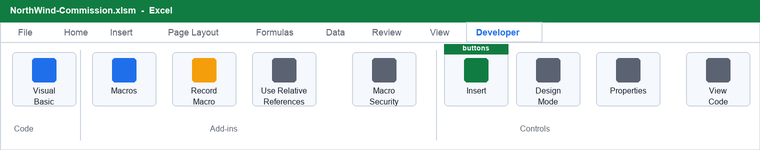
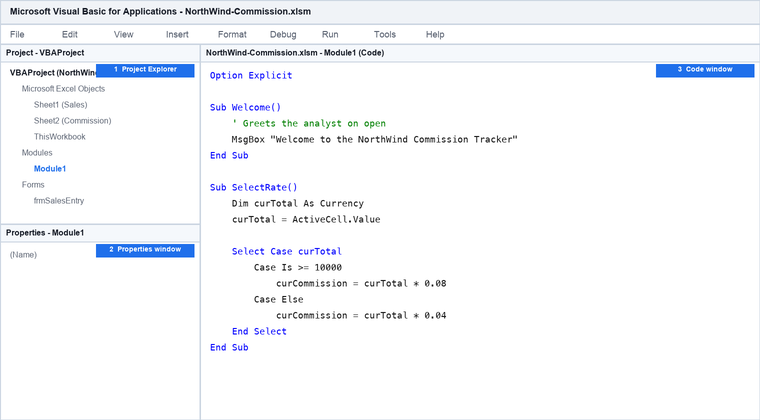
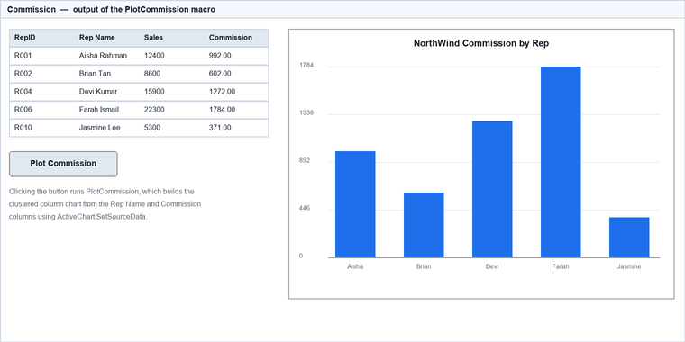
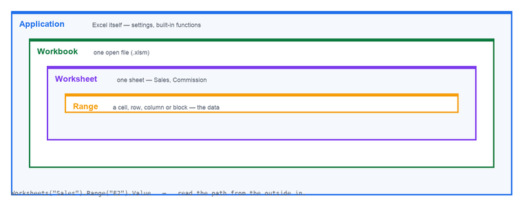
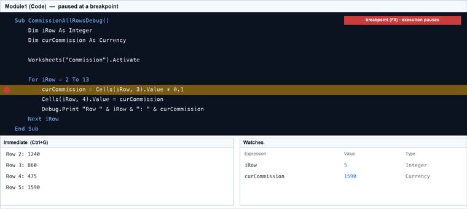
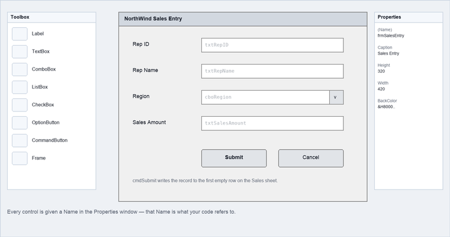

# AI Vibe Coding for Excel VBA — Learner Guide

**Course Code:** C357  |  **Conducted by:** Tertiary Infotech Academy Pte Ltd (UEN 201200696W)  |  **Version v1.0 · 28 September 2026**

## Contents

- [Introduction](#introduction)
- [AI Vibe Coding Playbook](#ai-vibe-coding-playbook)
- [Course Learning Outcomes](#course-learning-outcomes)
- [Before You Start — Environment Setup](#before-you-start--environment-setup)
- [Topic 01 — Get Started on VBA](#topic-01--get-started-on-vba)
  - [Lab 1 — Set Up the Developer Ribbon and Save a Macro-Enabled Workbook](#lab-1--set-up-the-developer-ribbon-and-save-a-macro-enabled-workbook)
  - [Lab 2 — Write Your First Macro in a Module](#lab-2--write-your-first-macro-in-a-module)
  - [Lab 3 — Message Boxes and Button Choices](#lab-3--message-boxes-and-button-choices)
  - [Lab 4 — Capture User Input with an Input Box](#lab-4--capture-user-input-with-an-input-box)
  - [Lab 5 — Record a Macro to Calculate Sales Tax](#lab-5--record-a-macro-to-calculate-sales-tax)
  - [Lab 6 — Run a Macro from a Button and a Shape](#lab-6--run-a-macro-from-a-button-and-a-shape)
- [Topic 02 — VBA Programming](#topic-02--vba-programming)
  - [Lab 7 — Declare Variables and Constants with the Right Data Type](#lab-7--declare-variables-and-constants-with-the-right-data-type)
  - [Lab 8 — Build Expressions with VBA Operators](#lab-8--build-expressions-with-vba-operators)
  - [Lab 9 — Branch with If…Then…ElseIf…Else](#lab-9--branch-with-ifthenelseifelse)
  - [Lab 10 — Simplify Banded Logic with Select Case](#lab-10--simplify-banded-logic-with-select-case)
  - [Lab 11 — Store a Column of Figures in an Array](#lab-11--store-a-column-of-figures-in-an-array)
  - [Lab 12 — Process Every Row with For…Next and For Each](#lab-12--process-every-row-with-fornext-and-for-each)
  - [Lab 13 — Find the First Empty Row with Do…While and Do…Until](#lab-13--find-the-first-empty-row-with-dowhile-and-dountil)
- [Topic 03 — Function and Sub Procedure](#topic-03--function-and-sub-procedure)
  - [Lab 14 — Write a Reusable Function that Returns a Value](#lab-14--write-a-reusable-function-that-returns-a-value)
  - [Lab 15 — Compare a Function with a Sub Procedure](#lab-15--compare-a-function-with-a-sub-procedure)
  - [Lab 16 — Control Visibility with Public and Private Scope](#lab-16--control-visibility-with-public-and-private-scope)
  - [Lab 17 — Reuse Excel's Built-in Worksheet Functions](#lab-17--reuse-excels-built-in-worksheet-functions)
  - [Lab 18 — Generate a Commission Chart from Code](#lab-18--generate-a-commission-chart-from-code)
- [Topic 04 — Managing Excel Objects](#topic-04--managing-excel-objects)
  - [Lab 19 — Read and Write Cells with the Range Object](#lab-19--read-and-write-cells-with-the-range-object)
  - [Lab 20 — Copy Data Between Worksheets](#lab-20--copy-data-between-worksheets)
  - [Lab 21 — Automate Workbooks and Worksheets](#lab-21--automate-workbooks-and-worksheets)
  - [Lab 22 — Identify Syntax, Runtime and Logical Errors](#lab-22--identify-syntax-runtime-and-logical-errors)
  - [Lab 23 — Handle Runtime Errors with On Error GoTo](#lab-23--handle-runtime-errors-with-on-error-goto)
  - [Lab 24 — Debug with Breakpoints, Step Into and the Watch Window](#lab-24--debug-with-breakpoints-step-into-and-the-watch-window)
  - [Lab 25 — Find a Value and Handle the Not-Found Case](#lab-25--find-a-value-and-handle-the-not-found-case)
- [Topic 05 — Create User Defined Forms](#topic-05--create-user-defined-forms)
  - [Lab 26 — Respond to Workbook Events](#lab-26--respond-to-workbook-events)
  - [Lab 27 — Respond to Worksheet Events](#lab-27--respond-to-worksheet-events)
  - [Lab 28 — Design a UserForm for Sales Entry](#lab-28--design-a-userform-for-sales-entry)
  - [Lab 29 — Write the Form's Event Procedures](#lab-29--write-the-forms-event-procedures)
  - [Lab 30 — Validate Form Input and Document the Solution](#lab-30--validate-form-input-and-document-the-solution)
  - [Lab 31 — Capstone — Complete the NorthWind Commission Tracker](#lab-31--capstone--complete-the-northwind-commission-tracker)
- [Quick Reference — VBA Syntax](#quick-reference--vba-syntax)
- [Troubleshooting Common Problems](#troubleshooting-common-problems)
- [Glossary](#glossary)


## Introduction

This Learner Guide accompanies the course AI Vibe Coding for Excel VBA (C357), conducted by Tertiary Infotech Academy Pte Ltd. It provides full step-by-step instructions and worked solutions for all 31 hands-on labs, organised by the five course topics. Every lab maps to a course learning outcome.

The course slides introduce each concept visually; this guide carries the detail. Whenever a slide shows you what a lab produces, the matching section here tells you exactly which keys to press, which code to type and how to confirm it worked. Keep this guide open beside Excel as you work.

**The running case study**

Every lab in this course builds one realistic deliverable: an automated commission tracker for the sales team of NorthWind Trading, a Singapore distributor. You start by framing a task for an AI coding assistant, and finish with a reviewed and tested UserForm solution that captures a sale, calculates banded commission, handles bad input and plots the result. Every lab retains its prompt, generated VBA and test evidence. Every lab adds one more capability to the same workbook, so by the final lab you have a complete, working business tool rather than 31 disconnected exercises.

**How each lab is laid out**

- Goal — the business problem the lab solves.
- What you'll build — the concrete artefact you finish with.
- Your Excel files — the start and end workbooks supplied for that lab.
- Mock data — the realistic dataset supplied for the lab, found in labs/data/.
- AI Vibe Coding — a copy-ready prompt, code-review checklist and evidence-led refinement prompt.
- Step-by-step — numbered instructions to follow in Excel.
- The code — the complete worked VBA solution for the lab.
- Test it — how to prove your work is correct before moving on.

**Every lab ships its own Excel files**

Each lab has its own folder in the course materials containing two macro-enabled workbooks and the worked VBA source:

- lab-NN-start.xlsm — the workbook exactly as it stands BEFORE the lab. This is the file you open.
- lab-NN-end.xlsm — the workbook AFTER the lab with a runnable lab-specific VBA checkpoint embedded. Use it to check your own work, or as a clean starting point for the next lab.
- vba/ — the completed procedures as importable files (.bas for standard modules, .cls for workbook and worksheet event code, .frm for the UserForm).

Because all 31 labs build the same workbook, each lab's start file is identical to the previous lab's end file. Work straight through with a single workbook of your own if you prefer — the supplied files simply mean you can rejoin the course at any lab, or recover instantly if a workbook is lost or corrupted.

Every workbook also carries two reference sheets: 'ReadMe (This File)' describing what that file contains and what the lab asks of you, and 'Macros' listing the VBA that belongs to that state.

Every workbook is a genuine macro-enabled file (.xlsm) with an embedded VBA project. The start workbook contains a safe lab-launch macro; the end workbook contains a runnable lab-specific checkpoint. The complete worked source remains available in each lab's vba folder for inspection, comparison and import into the correct standard, workbook, worksheet or UserForm component. Learners still generate, review and adapt their own code: the embedded solution is the verification checkpoint, not a substitute for explaining and testing the code.


## AI Vibe Coding Playbook

AI vibe coding is a supervised prompt-to-code workflow: describe the Excel task and workbook context, ask an AI assistant for VBA, inspect every line, paste or import the code into the correct VBA component, test it against known results, and refine the prompt or code until the acceptance criteria pass.

**The six-stage workflow**

- Frame — State the business goal, workbook context, worksheet/control names and expected result.
- Prompt — Ask for complete VBA with Option Explicit, clear placement instructions and no invented objects.
- Inspect — Check names, types, references, security implications and destructive actions before running.
- Run — Use a copy of the supplied .xlsm workbook and test with the lab's known inputs.
- Refine — Give the AI the exact error or failed acceptance result; request the smallest justified correction.
- Record — Keep the final prompt, generated code, test evidence and changes made by the learner.

**Safety and accountability guardrails**

- Never paste confidential, personal or production data into a public AI service.
- Treat AI-generated VBA as untrusted until it is reviewed and tested in a copy of the workbook.
- Reject unexplained file deletion, shell execution, network calls, credential access or hidden code.
- Require exact worksheet, range, control and procedure names; AI must not invent workbook objects.
- The learner remains accountable for correctness, security, documentation and the final code.

**Evidence to retain for every lab**

- The final prompt and the workbook context supplied to the AI.
- The generated VBA before learner edits, with the AI tool and date recorded.
- The learner's code changes and reasons for each change.
- The test inputs, expected results, actual results and any error messages.
- The final working .xlsm file and the reviewed source exported from the VBA Editor.


## Course Learning Outcomes

- LO1: Design a simple Excel interface using VBA, macros and an AI-assisted coding workflow
- LO2: Prompt AI to generate VBA, then review and adapt the code using appropriate programming methods and tools
- LO3: Create and validate AI-generated functions and procedures that meet design objectives
- LO4: Manage Excel object functionality and interoperability while testing and debugging AI-generated VBA
- LO5: Produce user-defined forms, documentation and auditable AI prompt-to-code evidence


## Before You Start — Environment Setup

**What you need**

- A PC or Mac with Microsoft Excel installed (Excel 2016 or later, or Microsoft 365). VBA is built in — there is nothing extra to buy or install.
- The Developer ribbon enabled — you switch this on in Lab 1.
- The lab mock-data files from the labs/data/ folder of the course materials, downloadable from the LMS.
- The per-lab start and end workbooks from the labs/ folder — one folder per lab, each holding lab-NN-start.xlsm, lab-NN-end.xlsm and the worked VBA source.
- About 50 MB of disk space for the workbooks you will build.

**A note for Mac users**

- The VBA Editor opens with Opt+F11 (or Fn+Opt+F11) instead of Alt+F11.
- Enable the Developer ribbon via Excel → Preferences → Ribbon & Toolbar → tick Developer.
- UserForms and ActiveX controls are limited on some Mac builds; where a lab uses a UserForm, your trainer will show the Mac-supported alternative.

**Enable macros safely**

Excel blocks macros by default. When you open a macro-enabled workbook you will see a yellow security bar; click Enable Content to allow the macros in that file to run. Only ever enable content in workbooks you or your trainer created.

**Conventions used in every lab**

- Menu paths are written as File → Options → Customize the Ribbon.
- Keyboard shortcuts are written as Alt+F11 (Windows) or Opt+F11 (Mac).
- Code you type into a module is shown in a shaded block in the monospaced font.
- An apostrophe (') at the start of a VBA line marks a comment — it is not executed.
- Save your workbook as .xlsm after every lab; saving as .xlsx silently deletes all your macros.

**The mock data**

Each lab that needs data ships its own CSV file under labs/data/. Open the CSV, copy the rows and paste them into the named worksheet, or open the CSV directly in Excel and copy from there. The figures are designed so that each commission band and edge case is exercised at least once.


## Topic 01 — Get Started on VBA

What VBA is · The Visual Basic Editor · Modules & procedures · Message and input boxes · Recording macros

Learning outcome: LO1.

**Key concepts**

- AI vibe coding — Turn a precise business intent into draft VBA with an AI assistant, then review, test and refine it before use.
- What is VBA? — Visual Basic for Applications — the event-driven language built into Excel that turns manual, repeated spreadsheet work into a one-click macro.
- Why automate? — A monthly report that takes an analyst two hours by hand runs in seconds, identically, every time — no copy-paste slips.
- The Visual Basic Editor — Press Alt+F11 (Windows) or Opt+F11 (Mac), or enable the Developer ribbon, to open the editor where all code lives.
- Modules and procedures — Code lives in a Module; a Module holds Procedures — Sub procedures that do things and Functions that return values.
- Talking to the user — MsgBox displays a message and captures a button choice; InputBox prompts the user to type a value.
- The macro recorder — Record your clicks into working VBA, then read and edit the generated code — the fastest way to learn Excel's object model.
- Macro-enabled files — A workbook containing macros must be saved as .xlsm — save it as .xlsx and every macro is silently discarded.
- Running a macro — Run from the editor (F5), from View → Macros, or by assigning the macro to a button or shape on the worksheet.


### Lab 1 — Set Up the Developer Ribbon and Save a Macro-Enabled Workbook

Objective: this lab develops your ability to access the VBA development environment and save work in the correct macro-enabled format.

**Goal**

You have just joined NorthWind Trading as a sales analyst. Before you can automate anything, you must switch on Excel's Developer tools, open the Visual Basic Editor, and learn why a workbook containing macros has to be saved as .xlsm.

**What you'll build**

A macro-enabled workbook, NorthWind-Commission.xlsm, with the Developer ribbon enabled and the VBA Editor open.   (Tools used: Excel, Developer ribbon, Visual Basic Editor.)

**Your Excel files**

- Open: labs/lab-01-set-up-the-developer-ribbon-and-save-a-macro-enabled-workbook/lab-01-start.xlsm — This is a blank workbook — Lab 1 starts from nothing, which is the point of the lab.
- Check against: labs/lab-01-set-up-the-developer-ribbon-and-save-a-macro-enabled-workbook/lab-01-end.xlsm — the completed workbook for this lab.
- Worked VBA to import if needed: labs/lab-01-set-up-the-developer-ribbon-and-save-a-macro-enabled-workbook/vba/

**Mock data**

Mock data: 12 NorthWind sales records for January (rep, region, product, sales amount).  The dataset is supplied as labs/data/northwind-sales-jan.csv.

**AI Vibe Coding — generate the first draft**

Copy this prompt into an approved AI assistant. Replace no workbook names, and do not paste confidential, personal or production data.

```vba
You are an Excel VBA coding assistant. Generate a complete, readable VBA solution for
Lab 1: Set Up the Developer Ribbon and Save a Macro-Enabled Workbook.

Business context: You have just joined NorthWind Trading as a sales analyst. Before you can automate anything, you must switch on Excel's Developer tools, open the Visual Basic Editor, and learn why a workbook containing macros has to be saved as .xlsm.
Workbook goal: A macro-enabled workbook, NorthWind-Commission.xlsm, with the Developer ribbon enabled and the VBA Editor open.
Available workbook context: Mock data: 12 NorthWind sales records for January (rep, region, product, sales amount).
Required VBA concepts/tools: Excel, Developer ribbon, Visual Basic Editor
Component placement: Place the generated procedure in a standard module named Module1.
Acceptance test: The Developer tab is visible, Alt+F11 opens the Visual Basic Editor, the Sales sheet holds 12 data rows, and the title bar reads NorthWind-Commission.xlsm.

Requirements:
- Start standard modules with Option Explicit.
- Use the exact worksheet, range, control and procedure names stated above; do not invent objects.
- Declare every variable with an appropriate data type.
- Keep the procedure focused on this lab and add short comments explaining intent.
- Qualify Workbook, Worksheet and Range references where practical.
- Add safe error handling when the requested operation can fail.
- Do not delete files, call the shell, access credentials, use the network or hide code.
- Return: (1) where the code belongs, (2) one complete VBA code block, and
  (3) three manual test cases including the acceptance test.
```

**Review before you run**

- Placement: the code is in the correct Module, ThisWorkbook, worksheet or UserForm component.
- Names: every worksheet, range, control and procedure name exists in the supplied workbook.
- Logic: the business rule and boundary cases match the lab goal; no unexplained magic values remain.
- Safety: there are no unexpected file, shell, network, credential, deletion or hidden-code operations.
- Quality: variables are declared, the code is readable, and errors are handled where appropriate.
- Evidence: the code passes this acceptance test — The Developer tab is visible, Alt+F11 opens the Visual Basic Editor, the Sales sheet holds 12 data rows, and the title bar reads NorthWind-Commission.xlsm.

**Refine with evidence**

```vba
The VBA did not yet pass Lab 1. Here is the exact error message or failed result: [PASTE EVIDENCE]. Here is the current code: [PASTE CODE]. Diagnose the smallest root cause, return only the corrected procedure, explain each changed line, and keep all working behaviour unchanged. Re-check against this acceptance test: The Developer tab is visible, Alt+F11 opens the Visual Basic Editor, the Sales sheet holds 12 data rows, and the title bar reads NorthWind-Commission.xlsm.
```

**Step-by-step**

1. Open Excel and create a new blank workbook.
2. Click File → Options → Customize the Ribbon, tick 'Developer' in the right-hand list, then click OK.
3. Confirm the Developer tab now appears on the ribbon, and click Developer → Visual Basic.
4. In the VBA Editor, note the Project Explorer on the left showing VBAProject (Book1) with its Sheet and ThisWorkbook objects.
5. Close the editor with Alt+Q, then import the mock data: paste the northwind-sales-jan.csv contents into Sheet1 starting at cell A1.
6. Rename Sheet1 to 'Sales' by double-clicking the sheet tab.
7. Click File → Save As, choose 'Excel Macro-Enabled Workbook (*.xlsm)', and save as NorthWind-Commission.xlsm.
8. Deliberately try File → Save As with the plain .xlsx type and read Excel's warning that macro-free workbooks discard VBA — then cancel.

**The code**

```vba
Sub VerifyVBAEnvironment()
    ' AI-generated environment check for Lab 1
    MsgBox "VBA is enabled. Save this workbook as .xlsm before continuing.", _
           vbInformation, "AI Vibe Coding for Excel VBA"
End Sub
```



*Figure 1 — The Developer ribbon — the Code and Controls groups you use throughout this course.*

**Test it**

The Developer tab is visible, Alt+F11 opens the Visual Basic Editor, the Sales sheet holds 12 data rows, and the title bar reads NorthWind-Commission.xlsm.

---


### Lab 2 — Write Your First Macro in a Module

Objective: this lab develops your ability to insert a module and write, save and run a first Sub procedure.

**Goal**

The sales manager wants a friendly confirmation whenever the commission tool is opened. You will insert a Module, write your first Sub procedure, and run it from the editor and from the Macro dialog.

**What you'll build**

A Module1 containing a Welcome Sub procedure that greets the user with a message box.   (Tools used: Visual Basic Editor, Module, Sub procedure, MsgBox.)

**Your Excel files**

- Open: labs/lab-02-write-your-first-macro-in-a-module/lab-02-start.xlsm — This is the same workbook you finished Lab 1 with, so continue with your own file if you have it.
- Check against: labs/lab-02-write-your-first-macro-in-a-module/lab-02-end.xlsm — the completed workbook for this lab.
- Worked VBA to import if needed: labs/lab-02-write-your-first-macro-in-a-module/vba/

**Mock data**

Uses NorthWind-Commission.xlsm from Lab 1.

**AI Vibe Coding — generate the first draft**

Copy this prompt into an approved AI assistant. Replace no workbook names, and do not paste confidential, personal or production data.

```vba
You are an Excel VBA coding assistant. Generate a complete, readable VBA solution for
Lab 2: Write Your First Macro in a Module.

Business context: The sales manager wants a friendly confirmation whenever the commission tool is opened. You will insert a Module, write your first Sub procedure, and run it from the editor and from the Macro dialog.
Workbook goal: A Module1 containing a Welcome Sub procedure that greets the user with a message box.
Available workbook context: Uses NorthWind-Commission.xlsm from Lab 1.
Required VBA concepts/tools: Visual Basic Editor, Module, Sub procedure, MsgBox
Component placement: Place the generated procedure in a standard module named Module1.
Acceptance test: Running the Welcome macro from either the editor or the Macros dialog shows the message box 'Welcome to the NorthWind Commission Tracker'.

Requirements:
- Start standard modules with Option Explicit.
- Use the exact worksheet, range, control and procedure names stated above; do not invent objects.
- Declare every variable with an appropriate data type.
- Keep the procedure focused on this lab and add short comments explaining intent.
- Qualify Workbook, Worksheet and Range references where practical.
- Add safe error handling when the requested operation can fail.
- Do not delete files, call the shell, access credentials, use the network or hide code.
- Return: (1) where the code belongs, (2) one complete VBA code block, and
  (3) three manual test cases including the acceptance test.
```

**Review before you run**

- Placement: the code is in the correct Module, ThisWorkbook, worksheet or UserForm component.
- Names: every worksheet, range, control and procedure name exists in the supplied workbook.
- Logic: the business rule and boundary cases match the lab goal; no unexplained magic values remain.
- Safety: there are no unexpected file, shell, network, credential, deletion or hidden-code operations.
- Quality: variables are declared, the code is readable, and errors are handled where appropriate.
- Evidence: the code passes this acceptance test — Running the Welcome macro from either the editor or the Macros dialog shows the message box 'Welcome to the NorthWind Commission Tracker'.

**Refine with evidence**

```vba
The VBA did not yet pass Lab 2. Here is the exact error message or failed result: [PASTE EVIDENCE]. Here is the current code: [PASTE CODE]. Diagnose the smallest root cause, return only the corrected procedure, explain each changed line, and keep all working behaviour unchanged. Re-check against this acceptance test: Running the Welcome macro from either the editor or the Macros dialog shows the message box 'Welcome to the NorthWind Commission Tracker'.
```

**Step-by-step**

1. Open NorthWind-Commission.xlsm and press Alt+F11 to open the VBA Editor.
2. Choose Insert → Module from the menu; Module1 appears under the project.
3. In the code window, type the Welcome procedure exactly as shown in the Learner Guide.
4. Note that typing 'Sub Welcome()' and pressing Enter makes the editor add 'End Sub' automatically.
5. Place the cursor inside the procedure and press F5 to run it; the message box appears.
6. Click OK, then press Alt+Q to return to Excel.
7. Click Developer → Macros (or View → Macros), select Welcome, and click Run.
8. Save the workbook with Ctrl+S, keeping the .xlsm format.

**The code**

```vba
Sub Welcome()
    ' Greets the analyst when the commission tool is opened
    MsgBox "Welcome to the NorthWind Commission Tracker"
End Sub
```



*Figure 2 — The Visual Basic Editor: Project Explorer, Properties window and Code window.*

**Test it**

Running the Welcome macro from either the editor or the Macros dialog shows the message box 'Welcome to the NorthWind Commission Tracker'.

---


### Lab 3 — Message Boxes and Button Choices

Objective: this lab develops your ability to use MsgBox to display information and capture the user's button choice.

**Goal**

Before the tool recalculates commissions it must ask the user to confirm, because the operation overwrites last month's figures. You will use MsgBox with the vbYesNoCancel button set and read back which button was clicked.

**What you'll build**

A ConfirmRecalculate Sub that asks the user to proceed and reports the button they chose.   (Tools used: MsgBox, vbYesNoCancel, vbYes/vbNo/vbCancel constants.)

**Your Excel files**

- Open: labs/lab-03-message-boxes-and-button-choices/lab-03-start.xlsm — This is the same workbook you finished Lab 2 with, so continue with your own file if you have it.
- Check against: labs/lab-03-message-boxes-and-button-choices/lab-03-end.xlsm — the completed workbook for this lab.
- Worked VBA to import if needed: labs/lab-03-message-boxes-and-button-choices/vba/

**Mock data**

Uses NorthWind-Commission.xlsm from Lab 2.

**AI Vibe Coding — generate the first draft**

Copy this prompt into an approved AI assistant. Replace no workbook names, and do not paste confidential, personal or production data.

```vba
You are an Excel VBA coding assistant. Generate a complete, readable VBA solution for
Lab 3: Message Boxes and Button Choices.

Business context: Before the tool recalculates commissions it must ask the user to confirm, because the operation overwrites last month's figures. You will use MsgBox with the vbYesNoCancel button set and read back which button was clicked.
Workbook goal: A ConfirmRecalculate Sub that asks the user to proceed and reports the button they chose.
Available workbook context: Uses NorthWind-Commission.xlsm from Lab 2.
Required VBA concepts/tools: MsgBox, vbYesNoCancel, vbYes/vbNo/vbCancel constants
Component placement: Place the generated procedure in a standard module named Module1.
Acceptance test: Each of the three buttons produces a different, correct follow-up message — Yes, No and Cancel are distinguished.

Requirements:
- Start standard modules with Option Explicit.
- Use the exact worksheet, range, control and procedure names stated above; do not invent objects.
- Declare every variable with an appropriate data type.
- Keep the procedure focused on this lab and add short comments explaining intent.
- Qualify Workbook, Worksheet and Range references where practical.
- Add safe error handling when the requested operation can fail.
- Do not delete files, call the shell, access credentials, use the network or hide code.
- Return: (1) where the code belongs, (2) one complete VBA code block, and
  (3) three manual test cases including the acceptance test.
```

**Review before you run**

- Placement: the code is in the correct Module, ThisWorkbook, worksheet or UserForm component.
- Names: every worksheet, range, control and procedure name exists in the supplied workbook.
- Logic: the business rule and boundary cases match the lab goal; no unexplained magic values remain.
- Safety: there are no unexpected file, shell, network, credential, deletion or hidden-code operations.
- Quality: variables are declared, the code is readable, and errors are handled where appropriate.
- Evidence: the code passes this acceptance test — Each of the three buttons produces a different, correct follow-up message — Yes, No and Cancel are distinguished.

**Refine with evidence**

```vba
The VBA did not yet pass Lab 3. Here is the exact error message or failed result: [PASTE EVIDENCE]. Here is the current code: [PASTE CODE]. Diagnose the smallest root cause, return only the corrected procedure, explain each changed line, and keep all working behaviour unchanged. Re-check against this acceptance test: Each of the three buttons produces a different, correct follow-up message — Yes, No and Cancel are distinguished.
```

**Step-by-step**

1. Open the VBA Editor and select Module1.
2. Write the ConfirmRecalculate Sub shown in the Learner Guide, using MsgBox with the vbYesNoCancel argument.
3. Note the MsgBox syntax: MsgBox(prompt, buttons, title) — the buttons argument controls which buttons appear.
4. Store the result in a variable so the code can react to the user's answer.
5. Add an If…Then…Else block that reports 'Recalculating…', 'Cancelled by user' or 'Operation aborted'.
6. Run the macro and click Yes; confirm the correct branch executes.
7. Run it twice more, clicking No and then Cancel, confirming each branch.
8. Review the common button constants (vbOKOnly, vbOKCancel, vbAbortRetryIgnore, vbYesNoCancel, vbYesNo) in the Learner Guide table.

**The code**

```vba
Sub ConfirmRecalculate()

    Dim intAnswer As Integer

    intAnswer = MsgBox("Recalculate all commissions?", _
                       vbYesNoCancel, "Confirm")

    If intAnswer = vbYes Then
        MsgBox "Recalculating..."
    ElseIf intAnswer = vbNo Then
        MsgBox "Cancelled by user."
    Else
        MsgBox "Operation aborted."
    End If

End Sub
```

**Test it**

Each of the three buttons produces a different, correct follow-up message — Yes, No and Cancel are distinguished.

---


### Lab 4 — Capture User Input with an Input Box

Objective: this lab develops your ability to prompt the user for a value with InputBox and use it in a calculation.

**Goal**

Commission rates change between quarters, so the tool must not hard-code them. You will use InputBox to ask the analyst for the rate, apply it to the selected sale, and display the result.

**What you'll build**

A ShowCommission Sub that asks for a commission rate and reports the commission on the selected cell.   (Tools used: InputBox, ActiveCell, MsgBox.)

**Your Excel files**

- Open: labs/lab-04-capture-user-input-with-an-input-box/lab-04-start.xlsm — This is the same workbook you finished Lab 3 with, so continue with your own file if you have it.
- Check against: labs/lab-04-capture-user-input-with-an-input-box/lab-04-end.xlsm — the completed workbook for this lab.
- Worked VBA to import if needed: labs/lab-04-capture-user-input-with-an-input-box/vba/

**Mock data**

Uses the Sales sheet mock data from Lab 1.

**AI Vibe Coding — generate the first draft**

Copy this prompt into an approved AI assistant. Replace no workbook names, and do not paste confidential, personal or production data.

```vba
You are an Excel VBA coding assistant. Generate a complete, readable VBA solution for
Lab 4: Capture User Input with an Input Box.

Business context: Commission rates change between quarters, so the tool must not hard-code them. You will use InputBox to ask the analyst for the rate, apply it to the selected sale, and display the result.
Workbook goal: A ShowCommission Sub that asks for a commission rate and reports the commission on the selected cell.
Available workbook context: Uses the Sales sheet mock data from Lab 1.
Required VBA concepts/tools: InputBox, ActiveCell, MsgBox
Component placement: Place the generated procedure in a standard module named Module1.
Acceptance test: Entering 0.1 with the $22,300 sale selected reports a commission of $2,230.00.

Requirements:
- Start standard modules with Option Explicit.
- Use the exact worksheet, range, control and procedure names stated above; do not invent objects.
- Declare every variable with an appropriate data type.
- Keep the procedure focused on this lab and add short comments explaining intent.
- Qualify Workbook, Worksheet and Range references where practical.
- Add safe error handling when the requested operation can fail.
- Do not delete files, call the shell, access credentials, use the network or hide code.
- Return: (1) where the code belongs, (2) one complete VBA code block, and
  (3) three manual test cases including the acceptance test.
```

**Review before you run**

- Placement: the code is in the correct Module, ThisWorkbook, worksheet or UserForm component.
- Names: every worksheet, range, control and procedure name exists in the supplied workbook.
- Logic: the business rule and boundary cases match the lab goal; no unexplained magic values remain.
- Safety: there are no unexpected file, shell, network, credential, deletion or hidden-code operations.
- Quality: variables are declared, the code is readable, and errors are handled where appropriate.
- Evidence: the code passes this acceptance test — Entering 0.1 with the $22,300 sale selected reports a commission of $2,230.00.

**Refine with evidence**

```vba
The VBA did not yet pass Lab 4. Here is the exact error message or failed result: [PASTE EVIDENCE]. Here is the current code: [PASTE CODE]. Diagnose the smallest root cause, return only the corrected procedure, explain each changed line, and keep all working behaviour unchanged. Re-check against this acceptance test: Entering 0.1 with the $22,300 sale selected reports a commission of $2,230.00.
```

**Step-by-step**

1. Open the Sales sheet and click a cell in the Sales Amount column, for example E2.
2. In Module1, write the ShowCommission Sub given in the Learner Guide.
3. Use InputBox to prompt 'What is the commission rate? (e.g. 0.1 for 10%)'.
4. Read the selected sale with ActiveCell.Value.
5. Multiply the sale by the rate and store it in a commission variable.
6. Display the commission in a MsgBox, formatted as currency for readability.
7. Run the macro with a rate of 0.1 against Farah Ismail's $22,300 sale.
8. Run it again and click Cancel on the InputBox to observe that it returns an empty string.

**The code**

```vba
Sub ShowCommission()

    Dim curRate As Double
    Dim curSale As Currency
    Dim curCommission As Currency

    curRate = InputBox("What is the commission rate? (e.g. 0.1 for 10%)")
    curSale = ActiveCell.Value
    curCommission = curSale * curRate

    MsgBox "Commission: " & Format(curCommission, "$#,##0.00")

End Sub
```

**Test it**

Entering 0.1 with the $22,300 sale selected reports a commission of $2,230.00.

---


### Lab 5 — Record a Macro to Calculate Sales Tax

Objective: this lab develops your ability to use the macro recorder to generate VBA and then read the code it produces.

**Goal**

The fastest way to discover Excel's object model is to let Excel write the code for you. You will record the steps for calculating 9% GST on each NorthWind sale, then open the recorded macro and read what the recorder generated.

**What you'll build**

A recorded Cal_SalesTax macro plus your annotated reading of the generated code.   (Tools used: Macro Recorder, Developer ribbon, Module.)

**Your Excel files**

- Open: labs/lab-05-record-a-macro-to-calculate-sales-tax/lab-05-start.xlsm — This is the same workbook you finished Lab 4 with, so continue with your own file if you have it.
- Check against: labs/lab-05-record-a-macro-to-calculate-sales-tax/lab-05-end.xlsm — the completed workbook for this lab.
- Worked VBA to import if needed: labs/lab-05-record-a-macro-to-calculate-sales-tax/vba/

**Mock data**

Mock data: the January sales extended with a GST Rate column.  The dataset is supplied as labs/data/northwind-sales-tax.csv.

**AI Vibe Coding — generate the first draft**

Copy this prompt into an approved AI assistant. Replace no workbook names, and do not paste confidential, personal or production data.

```vba
You are an Excel VBA coding assistant. Generate a complete, readable VBA solution for
Lab 5: Record a Macro to Calculate Sales Tax.

Business context: The fastest way to discover Excel's object model is to let Excel write the code for you. You will record the steps for calculating 9% GST on each NorthWind sale, then open the recorded macro and read what the recorder generated.
Workbook goal: A recorded Cal_SalesTax macro plus your annotated reading of the generated code.
Available workbook context: Mock data: the January sales extended with a GST Rate column.
Required VBA concepts/tools: Macro Recorder, Developer ribbon, Module
Component placement: Place the generated procedure in a standard module named Module1.
Acceptance test: Running Cal_SalesTax re-creates the GST formula in E2, giving 1116 for Aisha Rahman's $12,400 sale.

Requirements:
- Start standard modules with Option Explicit.
- Use the exact worksheet, range, control and procedure names stated above; do not invent objects.
- Declare every variable with an appropriate data type.
- Keep the procedure focused on this lab and add short comments explaining intent.
- Qualify Workbook, Worksheet and Range references where practical.
- Add safe error handling when the requested operation can fail.
- Do not delete files, call the shell, access credentials, use the network or hide code.
- Return: (1) where the code belongs, (2) one complete VBA code block, and
  (3) three manual test cases including the acceptance test.
```

**Review before you run**

- Placement: the code is in the correct Module, ThisWorkbook, worksheet or UserForm component.
- Names: every worksheet, range, control and procedure name exists in the supplied workbook.
- Logic: the business rule and boundary cases match the lab goal; no unexplained magic values remain.
- Safety: there are no unexpected file, shell, network, credential, deletion or hidden-code operations.
- Quality: variables are declared, the code is readable, and errors are handled where appropriate.
- Evidence: the code passes this acceptance test — Running Cal_SalesTax re-creates the GST formula in E2, giving 1116 for Aisha Rahman's $12,400 sale.

**Refine with evidence**

```vba
The VBA did not yet pass Lab 5. Here is the exact error message or failed result: [PASTE EVIDENCE]. Here is the current code: [PASTE CODE]. Diagnose the smallest root cause, return only the corrected procedure, explain each changed line, and keep all working behaviour unchanged. Re-check against this acceptance test: Running Cal_SalesTax re-creates the GST formula in E2, giving 1116 for Aisha Rahman's $12,400 sale.
```

**Step-by-step**

1. Add a new sheet named 'SalesTax' and paste in the northwind-sales-tax.csv mock data.
2. Click Developer → Record Macro; name it Cal_SalesTax and choose 'This Workbook' from the Store macro in list, then click OK.
3. With recording running, click cell E2 and enter the formula =C2*D2, then press Enter.
4. Click Developer → Stop Recording.
5. Press Alt+F11 and open the module the recorder created to read the generated code.
6. Identify the recorder's use of Range(...).Select and ActiveCell.FormulaR1C1 in the generated lines.
7. Add a comment above the procedure describing what it does and when to run it.
8. Return to Excel, delete the value in E2, and re-run Cal_SalesTax from the Macros dialog to confirm it rebuilds the formula.

**The code**

```vba
' Generated by the macro recorder, then tidied and commented.
Sub Cal_SalesTax()
    ' Writes the GST formula (Sales Amount x GST Rate) into the active row
    Application.CutCopyMode = False
    ActiveCell.FormulaR1C1 = "=RC[-2]*RC[-1]"
End Sub
```

**Test it**

Running Cal_SalesTax re-creates the GST formula in E2, giving 1116 for Aisha Rahman's $12,400 sale.

---


### Lab 6 — Run a Macro from a Button and a Shape

Objective: this lab develops your ability to design a simple Excel interface by attaching macros to on-sheet controls.

**Goal**

Sales staff will not open the VBA Editor. You will give them a one-click interface by placing a Form Control button and an assigned shape on the worksheet, wiring each to a macro — this is the 'simple Excel interface' element of LO1.

**What you'll build**

A Sales sheet with a 'Calculate Commission' button and a shape that both launch macros.   (Tools used: Developer → Insert, Form Controls, Assign Macro, Shapes.)

**Your Excel files**

- Open: labs/lab-06-run-a-macro-from-a-button-and-a-shape/lab-06-start.xlsm — This is the same workbook you finished Lab 5 with, so continue with your own file if you have it.
- Check against: labs/lab-06-run-a-macro-from-a-button-and-a-shape/lab-06-end.xlsm — the completed workbook for this lab.
- Worked VBA to import if needed: labs/lab-06-run-a-macro-from-a-button-and-a-shape/vba/

**Mock data**

Uses NorthWind-Commission.xlsm from Lab 5.

**AI Vibe Coding — generate the first draft**

Copy this prompt into an approved AI assistant. Replace no workbook names, and do not paste confidential, personal or production data.

```vba
You are an Excel VBA coding assistant. Generate a complete, readable VBA solution for
Lab 6: Run a Macro from a Button and a Shape.

Business context: Sales staff will not open the VBA Editor. You will give them a one-click interface by placing a Form Control button and an assigned shape on the worksheet, wiring each to a macro — this is the 'simple Excel interface' element of LO1.
Workbook goal: A Sales sheet with a 'Calculate Commission' button and a shape that both launch macros.
Available workbook context: Uses NorthWind-Commission.xlsm from Lab 5.
Required VBA concepts/tools: Developer → Insert, Form Controls, Assign Macro, Shapes
Component placement: Place the generated procedure in a standard module named Module1.
Acceptance test: Clicking the 'Calculate Commission' button prompts for a rate, and clicking the shape shows the welcome message.

Requirements:
- Start standard modules with Option Explicit.
- Use the exact worksheet, range, control and procedure names stated above; do not invent objects.
- Declare every variable with an appropriate data type.
- Keep the procedure focused on this lab and add short comments explaining intent.
- Qualify Workbook, Worksheet and Range references where practical.
- Add safe error handling when the requested operation can fail.
- Do not delete files, call the shell, access credentials, use the network or hide code.
- Return: (1) where the code belongs, (2) one complete VBA code block, and
  (3) three manual test cases including the acceptance test.
```

**Review before you run**

- Placement: the code is in the correct Module, ThisWorkbook, worksheet or UserForm component.
- Names: every worksheet, range, control and procedure name exists in the supplied workbook.
- Logic: the business rule and boundary cases match the lab goal; no unexplained magic values remain.
- Safety: there are no unexpected file, shell, network, credential, deletion or hidden-code operations.
- Quality: variables are declared, the code is readable, and errors are handled where appropriate.
- Evidence: the code passes this acceptance test — Clicking the 'Calculate Commission' button prompts for a rate, and clicking the shape shows the welcome message.

**Refine with evidence**

```vba
The VBA did not yet pass Lab 6. Here is the exact error message or failed result: [PASTE EVIDENCE]. Here is the current code: [PASTE CODE]. Diagnose the smallest root cause, return only the corrected procedure, explain each changed line, and keep all working behaviour unchanged. Re-check against this acceptance test: Clicking the 'Calculate Commission' button prompts for a rate, and clicking the shape shows the welcome message.
```

**Step-by-step**

1. On the Sales sheet, click Developer → Insert → Button (Form Control) and drag a button near cell G2.
2. In the Assign Macro dialog that opens, select ShowCommission and click OK.
3. Right-click the button, choose Edit Text, and rename it 'Calculate Commission'.
4. Click any worksheet cell to deselect, then click your new button to confirm it runs the macro.
5. Insert → Shapes → Rounded Rectangle and draw it below the button; type 'Welcome' into the shape.
6. Right-click the shape, choose Assign Macro, select Welcome and click OK.
7. Click the shape to confirm the Welcome macro runs.
8. Save the workbook, keeping the .xlsm format.

**The code**

```vba
' Lab 6 wires existing macros to on-sheet controls — no new code required.
'   Developer -> Insert -> Button (Form Control) -> drag,
'       then Assign Macro -> ShowCommission
'   Right-click the button -> Edit Text -> "Calculate Commission"
'   Insert -> Shapes -> Rounded Rectangle -> right-click,
'       then Assign Macro -> Welcome
```


*Figure 6 — Developer → Insert gives you the Form Controls used to place a button on the sheet.*

**Test it**

Clicking the 'Calculate Commission' button prompts for a rate, and clicking the shape shows the welcome message.

---


## Topic 02 — VBA Programming

Variables & constants · Data types & arrays · Operators · Decisions · Loops

Learning outcome: LO2.

**Key concepts**

- Prompt-to-code specification — Tell the AI the exact workbook context, input cells, business rules, output and test case before asking for code.
- Variables — A named memory location whose value can change while the macro runs — declare it with Dim before you use it.
- Constants — A named value that must NOT change — declare with Const; attempting to reassign it raises an error.
- Data types — Integer, Long, Double, Currency, String, Boolean, Date, Variant — choosing the right type prevents overflow and rounding bugs.
- Option Explicit — Forces every variable to be declared, so a typo becomes a compile error instead of a silent empty value.
- Arrays — One variable holding many values, indexed from 0 — ideal for reading a column of figures into memory at once.
- Operators — Arithmetic (+ - * / ^), comparison (= <> > <), logical (And Or Not) and concatenation (&) build every expression.
- Decisions — If…Then…ElseIf…Else runs different code per condition; Select Case is cleaner when testing one value against many bands.
- Loops — For…Next counts, For Each walks a collection, Do While / Do Until repeat while a condition holds — Exit For / Exit Do break out early.


### Lab 7 — Declare Variables and Constants with the Right Data Type

Objective: this lab develops your ability to declare variables and constants using appropriate data types.

**Goal**

Hard-coded numbers scattered through a macro are impossible to maintain. You will rewrite the commission calculation using declared variables for the changing values and a Const for the GST rate that must never change, and see what happens when code tries to reassign a constant.

**What you'll build**

A CalculateNetCommission Sub using Dim variables with correct types and a Const GST rate.   (Tools used: Dim, Const, Option Explicit, Currency/Double/String/Integer types.)

**Your Excel files**

- Open: labs/lab-07-declare-variables-and-constants-with-the-right-data-type/lab-07-start.xlsm — This is the same workbook you finished Lab 6 with, so continue with your own file if you have it.
- Check against: labs/lab-07-declare-variables-and-constants-with-the-right-data-type/lab-07-end.xlsm — the completed workbook for this lab.
- Worked VBA to import if needed: labs/lab-07-declare-variables-and-constants-with-the-right-data-type/vba/

**Mock data**

Uses the Sales sheet mock data; commission rate 10%, GST fixed at 9%.

**AI Vibe Coding — generate the first draft**

Copy this prompt into an approved AI assistant. Replace no workbook names, and do not paste confidential, personal or production data.

```vba
You are an Excel VBA coding assistant. Generate a complete, readable VBA solution for
Lab 7: Declare Variables and Constants with the Right Data Type.

Business context: Hard-coded numbers scattered through a macro are impossible to maintain. You will rewrite the commission calculation using declared variables for the changing values and a Const for the GST rate that must never change, and see what happens when code tries to reassign a constant.
Workbook goal: A CalculateNetCommission Sub using Dim variables with correct types and a Const GST rate.
Available workbook context: Uses the Sales sheet mock data; commission rate 10%, GST fixed at 9%.
Required VBA concepts/tools: Dim, Const, Option Explicit, Currency/Double/String/Integer types
Component placement: Place the generated procedure in a standard module named Module1.
Acceptance test: The macro reports commission and GST for the selected rep, and assigning to GST_RATE raises 'Assignment to constant not permitted'.

Requirements:
- Start standard modules with Option Explicit.
- Use the exact worksheet, range, control and procedure names stated above; do not invent objects.
- Declare every variable with an appropriate data type.
- Keep the procedure focused on this lab and add short comments explaining intent.
- Qualify Workbook, Worksheet and Range references where practical.
- Add safe error handling when the requested operation can fail.
- Do not delete files, call the shell, access credentials, use the network or hide code.
- Return: (1) where the code belongs, (2) one complete VBA code block, and
  (3) three manual test cases including the acceptance test.
```

**Review before you run**

- Placement: the code is in the correct Module, ThisWorkbook, worksheet or UserForm component.
- Names: every worksheet, range, control and procedure name exists in the supplied workbook.
- Logic: the business rule and boundary cases match the lab goal; no unexplained magic values remain.
- Safety: there are no unexpected file, shell, network, credential, deletion or hidden-code operations.
- Quality: variables are declared, the code is readable, and errors are handled where appropriate.
- Evidence: the code passes this acceptance test — The macro reports commission and GST for the selected rep, and assigning to GST_RATE raises 'Assignment to constant not permitted'.

**Refine with evidence**

```vba
The VBA did not yet pass Lab 7. Here is the exact error message or failed result: [PASTE EVIDENCE]. Here is the current code: [PASTE CODE]. Diagnose the smallest root cause, return only the corrected procedure, explain each changed line, and keep all working behaviour unchanged. Re-check against this acceptance test: The macro reports commission and GST for the selected rep, and assigning to GST_RATE raises 'Assignment to constant not permitted'.
```

**Step-by-step**

1. In the VBA Editor, type Option Explicit at the very top of Module1, above every procedure.
2. Create the CalculateNetCommission Sub as shown in the Learner Guide.
3. Declare Dim curSales As Currency, Dim curCommission As Currency and Dim strRep As String.
4. Declare Const GST_RATE As Double = 0.09 to hold the tax rate that must not change.
5. Read the rep name and sales amount from the active row using ActiveCell and Offset.
6. Calculate the commission at 10%, then the GST payable on it, and display both in a MsgBox.
7. Add the line GST_RATE = 0.07 inside the procedure and run it — read the compile error Excel raises.
8. Delete that line, then run the macro again successfully and review the data-type tables in the Learner Guide.

**The code**

```vba
Option Explicit

Sub CalculateNetCommission()

    Const GST_RATE As Double = 0.09      ' fixed by law - must not change

    Dim strRep As String
    Dim curSales As Currency
    Dim curCommission As Currency
    Dim curGST As Currency

    strRep = ActiveCell.Offset(0, -3).Value
    curSales = ActiveCell.Value

    curCommission = curSales * 0.1
    curGST = curCommission * GST_RATE

    MsgBox strRep & Chr(10) & _
           "Commission: " & Format(curCommission, "$#,##0.00") & Chr(10) & _
           "GST payable: " & Format(curGST, "$#,##0.00")

    ' GST_RATE = 0.07
    ' ^ uncomment to see "Assignment to constant not permitted"

End Sub
```

**Test it**

The macro reports commission and GST for the selected rep, and assigning to GST_RATE raises 'Assignment to constant not permitted'.

---


### Lab 8 — Build Expressions with VBA Operators

Objective: this lab develops your ability to apply arithmetic, comparison, logical and concatenation operators.

**Goal**

A commission engine is nothing but expressions. You will use all four operator families to compute a rep's gross commission, compare it against a bonus threshold, combine two conditions, and build a readable summary line for the manager's report.

**What you'll build**

A SummariseRep Sub that computes figures and concatenates a one-line summary sentence.   (Tools used: Arithmetic (+ - * /), comparison (> < =), logical (And Or Not), concatenation (&).)

**Your Excel files**

- Open: labs/lab-08-build-expressions-with-vba-operators/lab-08-start.xlsm — This is the same workbook you finished Lab 7 with, so continue with your own file if you have it.
- Check against: labs/lab-08-build-expressions-with-vba-operators/lab-08-end.xlsm — the completed workbook for this lab.
- Worked VBA to import if needed: labs/lab-08-build-expressions-with-vba-operators/vba/

**Mock data**

Mock data: quarterly targets per rep so comparisons have something realistic to test against.  The dataset is supplied as labs/data/northwind-targets.csv.

**AI Vibe Coding — generate the first draft**

Copy this prompt into an approved AI assistant. Replace no workbook names, and do not paste confidential, personal or production data.

```vba
You are an Excel VBA coding assistant. Generate a complete, readable VBA solution for
Lab 8: Build Expressions with VBA Operators.

Business context: A commission engine is nothing but expressions. You will use all four operator families to compute a rep's gross commission, compare it against a bonus threshold, combine two conditions, and build a readable summary line for the manager's report.
Workbook goal: A SummariseRep Sub that computes figures and concatenates a one-line summary sentence.
Available workbook context: Mock data: quarterly targets per rep so comparisons have something realistic to test against.
Required VBA concepts/tools: Arithmetic (+ - * /), comparison (> < =), logical (And Or Not), concatenation (&)
Component placement: Place the generated procedure in a standard module named Module1.
Acceptance test: Aisha Rahman is reported as above target with a loyalty bonus; Hui Ling Ong is reported as below target.

Requirements:
- Start standard modules with Option Explicit.
- Use the exact worksheet, range, control and procedure names stated above; do not invent objects.
- Declare every variable with an appropriate data type.
- Keep the procedure focused on this lab and add short comments explaining intent.
- Qualify Workbook, Worksheet and Range references where practical.
- Add safe error handling when the requested operation can fail.
- Do not delete files, call the shell, access credentials, use the network or hide code.
- Return: (1) where the code belongs, (2) one complete VBA code block, and
  (3) three manual test cases including the acceptance test.
```

**Review before you run**

- Placement: the code is in the correct Module, ThisWorkbook, worksheet or UserForm component.
- Names: every worksheet, range, control and procedure name exists in the supplied workbook.
- Logic: the business rule and boundary cases match the lab goal; no unexplained magic values remain.
- Safety: there are no unexpected file, shell, network, credential, deletion or hidden-code operations.
- Quality: variables are declared, the code is readable, and errors are handled where appropriate.
- Evidence: the code passes this acceptance test — Aisha Rahman is reported as above target with a loyalty bonus; Hui Ling Ong is reported as below target.

**Refine with evidence**

```vba
The VBA did not yet pass Lab 8. Here is the exact error message or failed result: [PASTE EVIDENCE]. Here is the current code: [PASTE CODE]. Diagnose the smallest root cause, return only the corrected procedure, explain each changed line, and keep all working behaviour unchanged. Re-check against this acceptance test: Aisha Rahman is reported as above target with a loyalty bonus; Hui Ling Ong is reported as below target.
```

**Step-by-step**

1. Add a sheet named 'Targets' and paste in the northwind-targets.csv mock data.
2. Write the SummariseRep Sub declaring variables for sales, target, commission and years of service.
3. Use arithmetic operators to compute commission as sales * 0.1 and variance as sales - target.
4. Use a comparison operator to test whether sales exceeded the target.
5. Use the And operator to test for a loyalty bonus: sales above target AND service of 3 years or more.
6. Use the & operator to concatenate the rep name, commission and verdict into one sentence.
7. Display the sentence with MsgBox and run it against Aisha Rahman's row.
8. Run it against Hui Ling Ong's row and confirm the below-target branch reports correctly.

**The code**

```vba
Sub SummariseRep()

    Dim strRep As String
    Dim curSales As Currency, curTarget As Currency
    Dim curCommission As Currency, curVariance As Currency
    Dim intYears As Integer
    Dim strVerdict As String

    strRep = ActiveCell.Offset(0, -1).Value
    curSales = ActiveCell.Value
    curTarget = ActiveCell.Offset(0, 1).Value
    intYears = ActiveCell.Offset(0, 2).Value

    curCommission = curSales * 0.1          ' arithmetic
    curVariance = curSales - curTarget

    If curSales > curTarget And intYears >= 3 Then      ' logical AND
        strVerdict = "above target with a loyalty bonus"
    ElseIf curSales > curTarget Then                    ' comparison
        strVerdict = "above target"
    Else
        strVerdict = "below target"
    End If

    ' concatenation
    MsgBox strRep & " earned " & Format(curCommission, "$#,##0.00") & _
           " and is " & strVerdict & " (variance " & _
           Format(curVariance, "$#,##0.00") & ")."

End Sub
```

**Test it**

Aisha Rahman is reported as above target with a loyalty bonus; Hui Ling Ong is reported as below target.

---


### Lab 9 — Branch with If…Then…ElseIf…Else

Objective: this lab develops your ability to control execution flow with conditional statements.

**Goal**

NorthWind pays banded commission: 8% above $10,000, 6% above $1,000, and 5% below that. You will implement the bands with If…Then…ElseIf…Else — the exact logic the capstone builds on.

**What you'll build**

An ElseIfCommission Sub that applies the correct banded rate to the selected sale.   (Tools used: If…Then, ElseIf, Else, End If, Round.)

**Your Excel files**

- Open: labs/lab-09-branch-with-ifthenelseifelse/lab-09-start.xlsm — This is the same workbook you finished Lab 8 with, so continue with your own file if you have it.
- Check against: labs/lab-09-branch-with-ifthenelseifelse/lab-09-end.xlsm — the completed workbook for this lab.
- Worked VBA to import if needed: labs/lab-09-branch-with-ifthenelseifelse/vba/

**Mock data**

Uses the Sales sheet — the mock data deliberately spans all three commission bands.

**AI Vibe Coding — generate the first draft**

Copy this prompt into an approved AI assistant. Replace no workbook names, and do not paste confidential, personal or production data.

```vba
You are an Excel VBA coding assistant. Generate a complete, readable VBA solution for
Lab 9: Branch with If…Then…ElseIf…Else.

Business context: NorthWind pays banded commission: 8% above $10,000, 6% above $1,000, and 5% below that. You will implement the bands with If…Then…ElseIf…Else — the exact logic the capstone builds on.
Workbook goal: An ElseIfCommission Sub that applies the correct banded rate to the selected sale.
Available workbook context: Uses the Sales sheet — the mock data deliberately spans all three commission bands.
Required VBA concepts/tools: If…Then, ElseIf, Else, End If, Round
Component placement: Place the generated procedure in a standard module named Module1.
Acceptance test: $22,300 yields $1,784.00 at 8%, $5,300 yields $318.00 at 6%, and $980 yields $49.00 at 5%.

Requirements:
- Start standard modules with Option Explicit.
- Use the exact worksheet, range, control and procedure names stated above; do not invent objects.
- Declare every variable with an appropriate data type.
- Keep the procedure focused on this lab and add short comments explaining intent.
- Qualify Workbook, Worksheet and Range references where practical.
- Add safe error handling when the requested operation can fail.
- Do not delete files, call the shell, access credentials, use the network or hide code.
- Return: (1) where the code belongs, (2) one complete VBA code block, and
  (3) three manual test cases including the acceptance test.
```

**Review before you run**

- Placement: the code is in the correct Module, ThisWorkbook, worksheet or UserForm component.
- Names: every worksheet, range, control and procedure name exists in the supplied workbook.
- Logic: the business rule and boundary cases match the lab goal; no unexplained magic values remain.
- Safety: there are no unexpected file, shell, network, credential, deletion or hidden-code operations.
- Quality: variables are declared, the code is readable, and errors are handled where appropriate.
- Evidence: the code passes this acceptance test — $22,300 yields $1,784.00 at 8%, $5,300 yields $318.00 at 6%, and $980 yields $49.00 at 5%.

**Refine with evidence**

```vba
The VBA did not yet pass Lab 9. Here is the exact error message or failed result: [PASTE EVIDENCE]. Here is the current code: [PASTE CODE]. Diagnose the smallest root cause, return only the corrected procedure, explain each changed line, and keep all working behaviour unchanged. Re-check against this acceptance test: $22,300 yields $1,784.00 at 8%, $5,300 yields $318.00 at 6%, and $980 yields $49.00 at 5%.
```

**Step-by-step**

1. Select a cell in the Sales Amount column on the Sales sheet.
2. Write the ElseIfCommission Sub declaring curCommission As Currency.
3. Add the first test: If ActiveCell.Value > 10000 Then apply an 8% rate.
4. Add an ElseIf branch for values above 1000 applying 6%.
5. Add a final Else branch applying 5%, then close the block with End If.
6. Wrap each calculation in Round(..., 2) so the currency value is sensible.
7. Display the band and commission in a MsgBox, then run it on Farah Ismail's $22,300 sale.
8. Re-run on Elson Goh's $980 and Jasmine Lee's $5,300 sales to prove all three branches work.

**The code**

```vba
Sub ElseIfCommission()

    Dim curSale As Currency
    Dim curCommission As Currency
    Dim strBand As String

    curSale = ActiveCell.Value

    If curSale > 10000 Then
        curCommission = Round(curSale * 0.08, 2)
        strBand = "8%"
    ElseIf curSale > 1000 Then
        curCommission = Round(curSale * 0.06, 2)
        strBand = "6%"
    Else
        curCommission = Round(curSale * 0.05, 2)
        strBand = "5%"
    End If

    MsgBox "Band: " & strBand & Chr(10) & _
           "Commission: " & Format(curCommission, "$#,##0.00")

End Sub
```

**Test it**

$22,300 yields $1,784.00 at 8%, $5,300 yields $318.00 at 6%, and $980 yields $49.00 at 5%.

---


### Lab 10 — Simplify Banded Logic with Select Case

Objective: this lab develops your ability to use Select Case as a clearer alternative to long ElseIf chains.

**Goal**

The finance team adds a fourth commission band, and the ElseIf chain is getting hard to read. You will rewrite the same logic with Select Case — the structure the capstone asks you to extend.

**What you'll build**

A SelectRate Sub implementing four commission bands with Select Case.   (Tools used: Select Case, Case Is, Case Else.)

**Your Excel files**

- Open: labs/lab-10-simplify-banded-logic-with-select-case/lab-10-start.xlsm — This is the same workbook you finished Lab 9 with, so continue with your own file if you have it.
- Check against: labs/lab-10-simplify-banded-logic-with-select-case/lab-10-end.xlsm — the completed workbook for this lab.
- Worked VBA to import if needed: labs/lab-10-simplify-banded-logic-with-select-case/vba/

**Mock data**

Bands: 8% ≥ $10,000 · 6% ≥ $1,000 · 5% ≥ $500 · 4% below $500.

**AI Vibe Coding — generate the first draft**

Copy this prompt into an approved AI assistant. Replace no workbook names, and do not paste confidential, personal or production data.

```vba
You are an Excel VBA coding assistant. Generate a complete, readable VBA solution for
Lab 10: Simplify Banded Logic with Select Case.

Business context: The finance team adds a fourth commission band, and the ElseIf chain is getting hard to read. You will rewrite the same logic with Select Case — the structure the capstone asks you to extend.
Workbook goal: A SelectRate Sub implementing four commission bands with Select Case.
Available workbook context: Bands: 8% ≥ $10,000 · 6% ≥ $1,000 · 5% ≥ $500 · 4% below $500.
Required VBA concepts/tools: Select Case, Case Is, Case Else
Component placement: Place the generated procedure in a standard module named Module1.
Acceptance test: Devi Kumar's $15,900 returns $1,272.00 at 8%, and Hui Ling Ong's $640 returns $32.00 at 5%.

Requirements:
- Start standard modules with Option Explicit.
- Use the exact worksheet, range, control and procedure names stated above; do not invent objects.
- Declare every variable with an appropriate data type.
- Keep the procedure focused on this lab and add short comments explaining intent.
- Qualify Workbook, Worksheet and Range references where practical.
- Add safe error handling when the requested operation can fail.
- Do not delete files, call the shell, access credentials, use the network or hide code.
- Return: (1) where the code belongs, (2) one complete VBA code block, and
  (3) three manual test cases including the acceptance test.
```

**Review before you run**

- Placement: the code is in the correct Module, ThisWorkbook, worksheet or UserForm component.
- Names: every worksheet, range, control and procedure name exists in the supplied workbook.
- Logic: the business rule and boundary cases match the lab goal; no unexplained magic values remain.
- Safety: there are no unexpected file, shell, network, credential, deletion or hidden-code operations.
- Quality: variables are declared, the code is readable, and errors are handled where appropriate.
- Evidence: the code passes this acceptance test — Devi Kumar's $15,900 returns $1,272.00 at 8%, and Hui Ling Ong's $640 returns $32.00 at 5%.

**Refine with evidence**

```vba
The VBA did not yet pass Lab 10. Here is the exact error message or failed result: [PASTE EVIDENCE]. Here is the current code: [PASTE CODE]. Diagnose the smallest root cause, return only the corrected procedure, explain each changed line, and keep all working behaviour unchanged. Re-check against this acceptance test: Devi Kumar's $15,900 returns $1,272.00 at 8%, and Hui Ling Ong's $640 returns $32.00 at 5%.
```

**Step-by-step**

1. Add a sheet named 'Commission' and copy the rep names and sales amounts across from the Sales sheet.
2. Write the SelectRate Sub, declaring curTotal As Currency and curCommission As Currency.
3. Read the selected sale into curTotal with ActiveCell.Value.
4. Open the block with Select Case curTotal.
5. Add Case Is >= 10000 applying 8%, then Case Is >= 1000 applying 6%, then Case Is >= 500 applying 5%.
6. Add Case Else applying 4%, then close with End Select.
7. Write the result back to the Commission column beside the sale rather than only showing a MsgBox.
8. Run the macro against several rows and confirm each lands in the right band.

**The code**

```vba
Sub SelectRate()

    Dim curTotal As Currency
    Dim curCommission As Currency

    curTotal = ActiveCell.Value

    Select Case curTotal
        Case Is >= 10000
            curCommission = curTotal * 0.08
        Case Is >= 1000
            curCommission = curTotal * 0.06
        Case Is >= 500
            curCommission = curTotal * 0.05
        Case Else
            curCommission = curTotal * 0.04
    End Select

    ' write the result beside the sale
    ActiveCell.Offset(0, 1).Value = Round(curCommission, 2)

End Sub
```

**Test it**

Devi Kumar's $15,900 returns $1,272.00 at 8%, and Hui Ling Ong's $640 returns $32.00 at 5%.

---


### Lab 11 — Store a Column of Figures in an Array

Objective: this lab develops your ability to declare an array and assign values to it by index.

**Goal**

Reading the same cells repeatedly is slow and fragile. You will load NorthWind's six monthly shipping charges into an array, then read them back by index — the foundation for loop processing.

**What you'll build**

A ShippingArray Sub that loads six monthly charges into an array and reports them.   (Tools used: Dim with parentheses, array index, Offset.)

**Your Excel files**

- Open: labs/lab-11-store-a-column-of-figures-in-an-array/lab-11-start.xlsm — This is the same workbook you finished Lab 10 with, so continue with your own file if you have it.
- Check against: labs/lab-11-store-a-column-of-figures-in-an-array/lab-11-end.xlsm — the completed workbook for this lab.
- Worked VBA to import if needed: labs/lab-11-store-a-column-of-figures-in-an-array/vba/

**Mock data**

Mock data: six months of shipping charges for the Central region.  The dataset is supplied as labs/data/northwind-shipping.csv.

**AI Vibe Coding — generate the first draft**

Copy this prompt into an approved AI assistant. Replace no workbook names, and do not paste confidential, personal or production data.

```vba
You are an Excel VBA coding assistant. Generate a complete, readable VBA solution for
Lab 11: Store a Column of Figures in an Array.

Business context: Reading the same cells repeatedly is slow and fragile. You will load NorthWind's six monthly shipping charges into an array, then read them back by index — the foundation for loop processing.
Workbook goal: A ShippingArray Sub that loads six monthly charges into an array and reports them.
Available workbook context: Mock data: six months of shipping charges for the Central region.
Required VBA concepts/tools: Dim with parentheses, array index, Offset
Component placement: Place the generated procedure in a standard module named Module1.
Acceptance test: The message box lists all six charges beginning with 320.5 and ending with 447.9.

Requirements:
- Start standard modules with Option Explicit.
- Use the exact worksheet, range, control and procedure names stated above; do not invent objects.
- Declare every variable with an appropriate data type.
- Keep the procedure focused on this lab and add short comments explaining intent.
- Qualify Workbook, Worksheet and Range references where practical.
- Add safe error handling when the requested operation can fail.
- Do not delete files, call the shell, access credentials, use the network or hide code.
- Return: (1) where the code belongs, (2) one complete VBA code block, and
  (3) three manual test cases including the acceptance test.
```

**Review before you run**

- Placement: the code is in the correct Module, ThisWorkbook, worksheet or UserForm component.
- Names: every worksheet, range, control and procedure name exists in the supplied workbook.
- Logic: the business rule and boundary cases match the lab goal; no unexplained magic values remain.
- Safety: there are no unexpected file, shell, network, credential, deletion or hidden-code operations.
- Quality: variables are declared, the code is readable, and errors are handled where appropriate.
- Evidence: the code passes this acceptance test — The message box lists all six charges beginning with 320.5 and ending with 447.9.

**Refine with evidence**

```vba
The VBA did not yet pass Lab 11. Here is the exact error message or failed result: [PASTE EVIDENCE]. Here is the current code: [PASTE CODE]. Diagnose the smallest root cause, return only the corrected procedure, explain each changed line, and keep all working behaviour unchanged. Re-check against this acceptance test: The message box lists all six charges beginning with 320.5 and ending with 447.9.
```

**Step-by-step**

1. Add a sheet named 'Shipping' and paste in the northwind-shipping.csv mock data.
2. Write the ShippingArray Sub and declare Dim curCharges(5) As Currency — six elements, indexed 0 to 5.
3. Declare Dim iCounter As Integer to hold the array index.
4. Activate the Shipping sheet and select cell B2, the first charge.
5. Assign each cell to its array element using ActiveCell.Offset(iCounter, 0).Value.
6. Read the array back and concatenate the six values into one string.
7. Display the string in a MsgBox and confirm all six charges appear in order.
8. Note in a comment why the array is declared as (5) yet holds six values — indexing starts at 0.

**The code**

```vba
Sub ShippingArray()

    Dim curCharges(5) As Currency     ' 6 elements, indexed 0 to 5
    Dim iCounter As Integer
    Dim strOut As String

    Worksheets("Shipping").Activate
    Range("B2").Activate

    For iCounter = 0 To 5
        curCharges(iCounter) = ActiveCell.Offset(iCounter, 0).Value
    Next iCounter

    For iCounter = 0 To 5
        strOut = strOut & "Month " & (iCounter + 1) & ": " & _
                 curCharges(iCounter) & Chr(10)
    Next iCounter

    MsgBox strOut

End Sub
```

**Test it**

The message box lists all six charges beginning with 320.5 and ending with 447.9.

---


### Lab 12 — Process Every Row with For…Next and For Each

Objective: this lab develops your ability to repeat operations over a range using counted and collection loops.

**Goal**

Twelve reps today, two hundred next year — the tool must scale. You will calculate commission for every row with a For…Next loop, then use For Each to walk a list of sales regions, and reverse the loop's direction to see how Step works.

**What you'll build**

A CommissionAllRows Sub and a ListRegions Sub demonstrating both loop styles.   (Tools used: For…Next, Step, For Each…Next, Exit For, Cells.)

**Your Excel files**

- Open: labs/lab-12-process-every-row-with-fornext-and-for-each/lab-12-start.xlsm — This is the same workbook you finished Lab 11 with, so continue with your own file if you have it.
- Check against: labs/lab-12-process-every-row-with-fornext-and-for-each/lab-12-end.xlsm — the completed workbook for this lab.
- Worked VBA to import if needed: labs/lab-12-process-every-row-with-fornext-and-for-each/vba/

**Mock data**

Uses the Commission sheet from Lab 10 (12 rows) plus a regions array.

**AI Vibe Coding — generate the first draft**

Copy this prompt into an approved AI assistant. Replace no workbook names, and do not paste confidential, personal or production data.

```vba
You are an Excel VBA coding assistant. Generate a complete, readable VBA solution for
Lab 12: Process Every Row with For…Next and For Each.

Business context: Twelve reps today, two hundred next year — the tool must scale. You will calculate commission for every row with a For…Next loop, then use For Each to walk a list of sales regions, and reverse the loop's direction to see how Step works.
Workbook goal: A CommissionAllRows Sub and a ListRegions Sub demonstrating both loop styles.
Available workbook context: Uses the Commission sheet from Lab 10 (12 rows) plus a regions array.
Required VBA concepts/tools: For…Next, Step, For Each…Next, Exit For, Cells
Component placement: Place the generated procedure in a standard module named Module1.
Acceptance test: All 12 commission cells populate in one run, and ListRegions stops after reporting North.

Requirements:
- Start standard modules with Option Explicit.
- Use the exact worksheet, range, control and procedure names stated above; do not invent objects.
- Declare every variable with an appropriate data type.
- Keep the procedure focused on this lab and add short comments explaining intent.
- Qualify Workbook, Worksheet and Range references where practical.
- Add safe error handling when the requested operation can fail.
- Do not delete files, call the shell, access credentials, use the network or hide code.
- Return: (1) where the code belongs, (2) one complete VBA code block, and
  (3) three manual test cases including the acceptance test.
```

**Review before you run**

- Placement: the code is in the correct Module, ThisWorkbook, worksheet or UserForm component.
- Names: every worksheet, range, control and procedure name exists in the supplied workbook.
- Logic: the business rule and boundary cases match the lab goal; no unexplained magic values remain.
- Safety: there are no unexpected file, shell, network, credential, deletion or hidden-code operations.
- Quality: variables are declared, the code is readable, and errors are handled where appropriate.
- Evidence: the code passes this acceptance test — All 12 commission cells populate in one run, and ListRegions stops after reporting North.

**Refine with evidence**

```vba
The VBA did not yet pass Lab 12. Here is the exact error message or failed result: [PASTE EVIDENCE]. Here is the current code: [PASTE CODE]. Diagnose the smallest root cause, return only the corrected procedure, explain each changed line, and keep all working behaviour unchanged. Re-check against this acceptance test: All 12 commission cells populate in one run, and ListRegions stops after reporting North.
```

**Step-by-step**

1. Open the Commission sheet holding the 12 NorthWind rows.
2. Write the CommissionAllRows Sub declaring iRow As Integer.
3. Loop with For iRow = 2 To 13 so the header row is skipped.
4. Inside the loop, read Cells(iRow, 3).Value and write the 10% commission into Cells(iRow, 4).
5. Run the macro and confirm all 12 commissions are filled in one click.
6. Write a second loop using Step -1 to walk from row 13 back to row 2, and observe the reversed order.
7. Write the ListRegions Sub with an array of Central, East, North and West, and walk it with For Each.
8. Add an Exit For that stops the loop as soon as 'North' is reached, and confirm the early exit.

**The code**

```vba
Sub CommissionAllRows()

    Dim iRow As Integer

    Worksheets("Commission").Activate

    For iRow = 2 To 13                       ' skip the header row
        Cells(iRow, 4).Value = Cells(iRow, 3).Value * 0.1
    Next iRow

    MsgBox "All commissions calculated."

End Sub


Sub CommissionReversed()

    Dim iRow As Integer

    For iRow = 13 To 2 Step -1               ' Step -1 walks backwards
        Debug.Print Cells(iRow, 2).Value
    Next iRow

End Sub


Sub ListRegions()

    Dim varRegion As Variant
    Dim strRegions As Variant

    strRegions = Array("Central", "East", "North", "West")

    For Each varRegion In strRegions
        MsgBox varRegion
        If varRegion = "North" Then Exit For      ' early exit
    Next

End Sub
```

**Test it**

All 12 commission cells populate in one run, and ListRegions stops after reporting North.

---


### Lab 13 — Find the First Empty Row with Do…While and Do…Until

Objective: this lab develops your ability to repeat operations while or until a condition is met.

**Goal**

New sales records must be appended below the existing ones, so the macro has to find the first empty row. You will solve this with a Do loop — the same technique your UserForm will use in Topic 5 to append records.

**What you'll build**

A FindFirstEmptyRow Sub that locates and reports the first blank row in the data.   (Tools used: Do While, Do Until, Loop, Exit Do, Offset, Activate.)

**Your Excel files**

- Open: labs/lab-13-find-the-first-empty-row-with-dowhile-and-dountil/lab-13-start.xlsm — This is the same workbook you finished Lab 12 with, so continue with your own file if you have it.
- Check against: labs/lab-13-find-the-first-empty-row-with-dowhile-and-dountil/lab-13-end.xlsm — the completed workbook for this lab.
- Worked VBA to import if needed: labs/lab-13-find-the-first-empty-row-with-dowhile-and-dountil/vba/

**Mock data**

Uses the Sales sheet; the mock data ends at row 13 so row 14 is the expected result.

**AI Vibe Coding — generate the first draft**

Copy this prompt into an approved AI assistant. Replace no workbook names, and do not paste confidential, personal or production data.

```vba
You are an Excel VBA coding assistant. Generate a complete, readable VBA solution for
Lab 13: Find the First Empty Row with Do…While and Do…Until.

Business context: New sales records must be appended below the existing ones, so the macro has to find the first empty row. You will solve this with a Do loop — the same technique your UserForm will use in Topic 5 to append records.
Workbook goal: A FindFirstEmptyRow Sub that locates and reports the first blank row in the data.
Available workbook context: Uses the Sales sheet; the mock data ends at row 13 so row 14 is the expected result.
Required VBA concepts/tools: Do While, Do Until, Loop, Exit Do, Offset, Activate
Component placement: Place the generated procedure in a standard module named Module1.
Acceptance test: Both the Do Until and Do While versions report 'First empty row: 14'.

Requirements:
- Start standard modules with Option Explicit.
- Use the exact worksheet, range, control and procedure names stated above; do not invent objects.
- Declare every variable with an appropriate data type.
- Keep the procedure focused on this lab and add short comments explaining intent.
- Qualify Workbook, Worksheet and Range references where practical.
- Add safe error handling when the requested operation can fail.
- Do not delete files, call the shell, access credentials, use the network or hide code.
- Return: (1) where the code belongs, (2) one complete VBA code block, and
  (3) three manual test cases including the acceptance test.
```

**Review before you run**

- Placement: the code is in the correct Module, ThisWorkbook, worksheet or UserForm component.
- Names: every worksheet, range, control and procedure name exists in the supplied workbook.
- Logic: the business rule and boundary cases match the lab goal; no unexplained magic values remain.
- Safety: there are no unexpected file, shell, network, credential, deletion or hidden-code operations.
- Quality: variables are declared, the code is readable, and errors are handled where appropriate.
- Evidence: the code passes this acceptance test — Both the Do Until and Do While versions report 'First empty row: 14'.

**Refine with evidence**

```vba
The VBA did not yet pass Lab 13. Here is the exact error message or failed result: [PASTE EVIDENCE]. Here is the current code: [PASTE CODE]. Diagnose the smallest root cause, return only the corrected procedure, explain each changed line, and keep all working behaviour unchanged. Re-check against this acceptance test: Both the Do Until and Do While versions report 'First empty row: 14'.
```

**Step-by-step**

1. Open the Sales sheet and confirm the data occupies rows 2 to 13.
2. Write the FindFirstEmptyRow Sub and activate cell A2 as the starting point.
3. Open a loop with Do Until ActiveCell.Value = "".
4. Inside the loop, move down one row with ActiveCell.Offset(1, 0).Activate.
5. Close the loop with the Loop keyword and report the found row with ActiveCell.Row.
6. Run the macro and confirm it reports row 14.
7. Rewrite the same logic as Do While ActiveCell.Value <> "" and confirm the identical result.
8. Add a safety counter that uses Exit Do after 1000 iterations so a bad condition cannot hang Excel.

**The code**

```vba
Sub FindFirstEmptyRow()

    Dim iSafety As Long

    Worksheets("Sales").Activate
    Range("A2").Activate

    Do Until ActiveCell.Value = ""
        ActiveCell.Offset(1, 0).Activate
        iSafety = iSafety + 1
        If iSafety > 1000 Then Exit Do        ' never hang Excel
    Loop

    MsgBox "First empty row: " & ActiveCell.Row

End Sub


Sub FindFirstEmptyRowWhile()

    Worksheets("Sales").Activate
    Range("A2").Activate

    Do While ActiveCell.Value <> ""           ' same result, opposite test
        ActiveCell.Offset(1, 0).Activate
    Loop

    MsgBox "First empty row: " & ActiveCell.Row

End Sub
```

**Test it**

Both the Do Until and Do While versions report 'First empty row: 14'.

---


## Topic 03 — Function and Sub Procedure

Function vs Sub · Arguments & return values · Scope · Worksheet functions · Charts

Learning outcome: LO3.

**Key concepts**

- AI-generated procedures — Ask for one small procedure with an explicit contract, then verify its arguments, return value, scope and side effects.
- Sub procedure — A block of statements between Sub and End Sub that performs an action but returns no value — this is what a macro button runs.
- Function procedure — Sits between Function and End Function and RETURNS a value by assigning to its own name — usable from a worksheet cell.
- The key difference — A Function may return a value; a Sub does not — know this distinction precisely.
- Arguments — Values passed into a procedure, e.g. Cal_Commission(curSales) — they make one procedure reusable for many inputs.
- Scope — Public procedures are visible to the whole project; Private ones only to their own module — control what other code can call.
- Modular design — Break a long macro into small, named procedures that each do one thing; call them from a short master Sub.
- Worksheet functions — Application.WorksheetFunction lets VBA reuse Excel's built-ins — Sum, Min, Max, Pmt — instead of re-implementing them.
- Charts from code — ActiveSheet.Shapes.AddChart with ChartType and SetSourceData builds a chart programmatically from a data range.


### Lab 14 — Write a Reusable Function that Returns a Value

Objective: this lab develops your ability to create a user-defined function that accepts arguments and returns a result.

**Goal**

The 10% commission calculation is now duplicated in three macros. You will extract it into a single user-defined Function that takes a sales figure and returns the commission — then call it from a worksheet cell exactly like SUM or AVERAGE.

**What you'll build**

A Cal_Commission function callable from both VBA and any worksheet cell.   (Tools used: Function…End Function, arguments, return value, UDF in a cell.)

**Your Excel files**

- Open: labs/lab-14-write-a-reusable-function-that-returns-a-value/lab-14-start.xlsm — This is the same workbook you finished Lab 13 with, so continue with your own file if you have it.
- Check against: labs/lab-14-write-a-reusable-function-that-returns-a-value/lab-14-end.xlsm — the completed workbook for this lab.
- Worked VBA to import if needed: labs/lab-14-write-a-reusable-function-that-returns-a-value/vba/

**Mock data**

Uses the Commission sheet mock data from Topic 2.

**AI Vibe Coding — generate the first draft**

Copy this prompt into an approved AI assistant. Replace no workbook names, and do not paste confidential, personal or production data.

```vba
You are an Excel VBA coding assistant. Generate a complete, readable VBA solution for
Lab 14: Write a Reusable Function that Returns a Value.

Business context: The 10% commission calculation is now duplicated in three macros. You will extract it into a single user-defined Function that takes a sales figure and returns the commission — then call it from a worksheet cell exactly like SUM or AVERAGE.
Workbook goal: A Cal_Commission function callable from both VBA and any worksheet cell.
Available workbook context: Uses the Commission sheet mock data from Topic 2.
Required VBA concepts/tools: Function…End Function, arguments, return value, UDF in a cell
Component placement: Place the generated procedure in a standard module named Module1.
Acceptance test: =Cal_Commission(C2) in a worksheet cell returns 1240 for Aisha Rahman's $12,400 sale.

Requirements:
- Start standard modules with Option Explicit.
- Use the exact worksheet, range, control and procedure names stated above; do not invent objects.
- Declare every variable with an appropriate data type.
- Keep the procedure focused on this lab and add short comments explaining intent.
- Qualify Workbook, Worksheet and Range references where practical.
- Add safe error handling when the requested operation can fail.
- Do not delete files, call the shell, access credentials, use the network or hide code.
- Return: (1) where the code belongs, (2) one complete VBA code block, and
  (3) three manual test cases including the acceptance test.
```

**Review before you run**

- Placement: the code is in the correct Module, ThisWorkbook, worksheet or UserForm component.
- Names: every worksheet, range, control and procedure name exists in the supplied workbook.
- Logic: the business rule and boundary cases match the lab goal; no unexplained magic values remain.
- Safety: there are no unexpected file, shell, network, credential, deletion or hidden-code operations.
- Quality: variables are declared, the code is readable, and errors are handled where appropriate.
- Evidence: the code passes this acceptance test — =Cal_Commission(C2) in a worksheet cell returns 1240 for Aisha Rahman's $12,400 sale.

**Refine with evidence**

```vba
The VBA did not yet pass Lab 14. Here is the exact error message or failed result: [PASTE EVIDENCE]. Here is the current code: [PASTE CODE]. Diagnose the smallest root cause, return only the corrected procedure, explain each changed line, and keep all working behaviour unchanged. Re-check against this acceptance test: =Cal_Commission(C2) in a worksheet cell returns 1240 for Aisha Rahman's $12,400 sale.
```

**Step-by-step**

1. In Module1, create a new procedure beginning Function Cal_Commission(curSales As Currency) As Currency.
2. Inside the function, assign the result to the function's own name: Cal_Commission = curSales * 0.1.
3. Close the procedure with End Function.
4. Return to Excel, click an empty cell on the Commission sheet, and type =Cal_Commission(C2).
5. Press Enter and confirm the cell shows 10% of the sale — your function now behaves like a built-in.
6. Fill the formula down the column to apply it to all 12 reps.
7. Write a short Sub that also calls Cal_Commission and shows the result in a MsgBox, proving one function serves both callers.
8. Add a comment above the function documenting its argument, its return value and its rate assumption.

**The code**

```vba
Function Cal_Commission(curSales As Currency) As Currency
    ' Returns 10% commission on the sales figure supplied.
    ' Callable from VBA AND from any worksheet cell:  =Cal_Commission(C2)
    Cal_Commission = curSales * 0.1
End Function


Sub UseTheFunction()
    Dim curPay As Currency
    curPay = Cal_Commission(ActiveCell.Value)
    MsgBox "Commission: " & Format(curPay, "$#,##0.00")
End Sub
```

**Test it**

=Cal_Commission(C2) in a worksheet cell returns 1240 for Aisha Rahman's $12,400 sale.

---


### Lab 15 — Compare a Function with a Sub Procedure

Objective: this lab develops your ability to distinguish a Function from a Sub procedure and choose the right one.

**Goal**

You will build the same commission logic twice — once as a Function that returns a value, once as a Sub that performs an action — and record precisely how they differ in use.

**What you'll build**

A matched pair, Cal_Commission (Function) and ShowCommissionSub (Sub), plus a written comparison.   (Tools used: Function vs Sub, Call keyword, return values.)

**Your Excel files**

- Open: labs/lab-15-compare-a-function-with-a-sub-procedure/lab-15-start.xlsm — This is the same workbook you finished Lab 14 with, so continue with your own file if you have it.
- Check against: labs/lab-15-compare-a-function-with-a-sub-procedure/lab-15-end.xlsm — the completed workbook for this lab.
- Worked VBA to import if needed: labs/lab-15-compare-a-function-with-a-sub-procedure/vba/

**Mock data**

Uses the Commission sheet; no new data required.

**AI Vibe Coding — generate the first draft**

Copy this prompt into an approved AI assistant. Replace no workbook names, and do not paste confidential, personal or production data.

```vba
You are an Excel VBA coding assistant. Generate a complete, readable VBA solution for
Lab 15: Compare a Function with a Sub Procedure.

Business context: You will build the same commission logic twice — once as a Function that returns a value, once as a Sub that performs an action — and record precisely how they differ in use.
Workbook goal: A matched pair, Cal_Commission (Function) and ShowCommissionSub (Sub), plus a written comparison.
Available workbook context: Uses the Commission sheet; no new data required.
Required VBA concepts/tools: Function vs Sub, Call keyword, return values
Component placement: Place the generated procedure in a standard module named Module1.
Acceptance test: The Function works in a worksheet cell and returns a value; the Sub does not work in a cell but runs from the Macros dialog.

Requirements:
- Start standard modules with Option Explicit.
- Use the exact worksheet, range, control and procedure names stated above; do not invent objects.
- Declare every variable with an appropriate data type.
- Keep the procedure focused on this lab and add short comments explaining intent.
- Qualify Workbook, Worksheet and Range references where practical.
- Add safe error handling when the requested operation can fail.
- Do not delete files, call the shell, access credentials, use the network or hide code.
- Return: (1) where the code belongs, (2) one complete VBA code block, and
  (3) three manual test cases including the acceptance test.
```

**Review before you run**

- Placement: the code is in the correct Module, ThisWorkbook, worksheet or UserForm component.
- Names: every worksheet, range, control and procedure name exists in the supplied workbook.
- Logic: the business rule and boundary cases match the lab goal; no unexplained magic values remain.
- Safety: there are no unexpected file, shell, network, credential, deletion or hidden-code operations.
- Quality: variables are declared, the code is readable, and errors are handled where appropriate.
- Evidence: the code passes this acceptance test — The Function works in a worksheet cell and returns a value; the Sub does not work in a cell but runs from the Macros dialog.

**Refine with evidence**

```vba
The VBA did not yet pass Lab 15. Here is the exact error message or failed result: [PASTE EVIDENCE]. Here is the current code: [PASTE CODE]. Diagnose the smallest root cause, return only the corrected procedure, explain each changed line, and keep all working behaviour unchanged. Re-check against this acceptance test: The Function works in a worksheet cell and returns a value; the Sub does not work in a cell but runs from the Macros dialog.
```

**Step-by-step**

1. Review the Cal_Commission function you wrote in Lab 14.
2. Write a Sub named ShowCommissionSub that calculates the same figure and displays it with MsgBox.
3. Try to enter =ShowCommissionSub(C2) in a worksheet cell and observe that Excel rejects it — a Sub returns nothing.
4. Call the Sub correctly from another procedure using Call ShowCommissionSub, then again without the Call keyword.
5. Call the Function from a Sub and assign its result to a variable, proving it returns a usable value.
6. In the Learner Guide table, record the three differences: return value, callable from a cell, and how each is invoked.
7. Add a comment to each procedure stating why that form was chosen for that job.
8. Save the workbook.

**The code**

```vba
' A FUNCTION returns a value - usable in a worksheet cell
Function Cal_Commission(curSales As Currency) As Currency
    Cal_Commission = curSales * 0.1
End Function


' A SUB performs an action - NOT usable in a worksheet cell
Sub ShowCommissionSub()
    Dim curCommission As Currency
    curCommission = ActiveCell.Value * 0.1
    MsgBox "Commission: " & Format(curCommission, "$#,##0.00")
End Sub


Sub CallBoth()
    Dim curResult As Currency
    curResult = Cal_Commission(ActiveCell.Value)   ' returns a value
    Call ShowCommissionSub                          ' performs an action
End Sub
```

**Test it**

The Function works in a worksheet cell and returns a value; the Sub does not work in a cell but runs from the Macros dialog.

---


### Lab 16 — Control Visibility with Public and Private Scope

Objective: this lab develops your ability to apply Public and Private scope to control where procedures can be called.

**Goal**

The commission workbook now has helper procedures that should not appear in the user's Macros list. You will use Private and Public to control exactly what is exposed.

**What you'll build**

A module where internal helpers are Private and only the master macro is Public.   (Tools used: Public, Private, module scope, Macros dialog.)

**Your Excel files**

- Open: labs/lab-16-control-visibility-with-public-and-private-scope/lab-16-start.xlsm — This is the same workbook you finished Lab 15 with, so continue with your own file if you have it.
- Check against: labs/lab-16-control-visibility-with-public-and-private-scope/lab-16-end.xlsm — the completed workbook for this lab.
- Worked VBA to import if needed: labs/lab-16-control-visibility-with-public-and-private-scope/vba/

**Mock data**

Uses NorthWind-Commission.xlsm as built so far.

**AI Vibe Coding — generate the first draft**

Copy this prompt into an approved AI assistant. Replace no workbook names, and do not paste confidential, personal or production data.

```vba
You are an Excel VBA coding assistant. Generate a complete, readable VBA solution for
Lab 16: Control Visibility with Public and Private Scope.

Business context: The commission workbook now has helper procedures that should not appear in the user's Macros list. You will use Private and Public to control exactly what is exposed.
Workbook goal: A module where internal helpers are Private and only the master macro is Public.
Available workbook context: Uses NorthWind-Commission.xlsm as built so far.
Required VBA concepts/tools: Public, Private, module scope, Macros dialog
Component placement: Place the generated procedure in a standard module named Module1.
Acceptance test: Only the Public procedures are listed in the Macros dialog, and Module2 cannot call the Private helper.

Requirements:
- Start standard modules with Option Explicit.
- Use the exact worksheet, range, control and procedure names stated above; do not invent objects.
- Declare every variable with an appropriate data type.
- Keep the procedure focused on this lab and add short comments explaining intent.
- Qualify Workbook, Worksheet and Range references where practical.
- Add safe error handling when the requested operation can fail.
- Do not delete files, call the shell, access credentials, use the network or hide code.
- Return: (1) where the code belongs, (2) one complete VBA code block, and
  (3) three manual test cases including the acceptance test.
```

**Review before you run**

- Placement: the code is in the correct Module, ThisWorkbook, worksheet or UserForm component.
- Names: every worksheet, range, control and procedure name exists in the supplied workbook.
- Logic: the business rule and boundary cases match the lab goal; no unexplained magic values remain.
- Safety: there are no unexpected file, shell, network, credential, deletion or hidden-code operations.
- Quality: variables are declared, the code is readable, and errors are handled where appropriate.
- Evidence: the code passes this acceptance test — Only the Public procedures are listed in the Macros dialog, and Module2 cannot call the Private helper.

**Refine with evidence**

```vba
The VBA did not yet pass Lab 16. Here is the exact error message or failed result: [PASTE EVIDENCE]. Here is the current code: [PASTE CODE]. Diagnose the smallest root cause, return only the corrected procedure, explain each changed line, and keep all working behaviour unchanged. Re-check against this acceptance test: Only the Public procedures are listed in the Macros dialog, and Module2 cannot call the Private helper.
```

**Step-by-step**

1. In Module1, add the Private keyword before your helper Sub: Private Sub ShowCommissionSub().
2. Return to Excel and open Developer → Macros; confirm the private procedure no longer appears in the list.
3. Mark your main entry-point procedure explicitly as Public Sub RunCommissionReport().
4. Confirm the public procedure still appears in the Macros dialog.
5. From RunCommissionReport, call the private helper and confirm code in the same module can still reach it.
6. Insert a second module, Module2, and try to call the private procedure from it — read the error.
7. Change the helper back to Public temporarily and confirm Module2 can now call it, then set it Private again.
8. Document in a comment which procedures form the tool's public interface.

**The code**

```vba
' Public = the tool's front door; appears in the Macros dialog
Public Sub RunCommissionReport()
    CalculateHelper              ' a Private helper in this module
    MsgBox "Report complete."
End Sub


' Private = internal only; hidden from the Macros dialog and other modules
Private Sub CalculateHelper()
    Dim iRow As Integer
    For iRow = 2 To 13
        Cells(iRow, 4).Value = Cells(iRow, 3).Value * 0.1
    Next iRow
End Sub
```

**Test it**

Only the Public procedures are listed in the Macros dialog, and Module2 cannot call the Private helper.

---


### Lab 17 — Reuse Excel's Built-in Worksheet Functions

Objective: this lab develops your ability to call Excel's built-in functions from VBA with Application.WorksheetFunction.

**Goal**

Do not re-implement what Excel already does. You will use Application.WorksheetFunction to total and summarise NorthWind's sales, and to compute a loan repayment with PMT for the company's new vehicle financing.

**What you'll build**

A SalesStatistics Sub reporting total, average, highest and lowest sales, plus a PMT calculation.   (Tools used: Application.WorksheetFunction (Sum, Average, Max, Min, Pmt), Range.)

**Your Excel files**

- Open: labs/lab-17-reuse-excels-built-in-worksheet-functions/lab-17-start.xlsm — This is the same workbook you finished Lab 16 with, so continue with your own file if you have it.
- Check against: labs/lab-17-reuse-excels-built-in-worksheet-functions/lab-17-end.xlsm — the completed workbook for this lab.
- Worked VBA to import if needed: labs/lab-17-reuse-excels-built-in-worksheet-functions/vba/

**Mock data**

Mock data: vehicle loan terms — $18,000 over 12 months at 6% annual interest.  The dataset is supplied as labs/data/northwind-loan.csv.

**AI Vibe Coding — generate the first draft**

Copy this prompt into an approved AI assistant. Replace no workbook names, and do not paste confidential, personal or production data.

```vba
You are an Excel VBA coding assistant. Generate a complete, readable VBA solution for
Lab 17: Reuse Excel's Built-in Worksheet Functions.

Business context: Do not re-implement what Excel already does. You will use Application.WorksheetFunction to total and summarise NorthWind's sales, and to compute a loan repayment with PMT for the company's new vehicle financing.
Workbook goal: A SalesStatistics Sub reporting total, average, highest and lowest sales, plus a PMT calculation.
Available workbook context: Mock data: vehicle loan terms — $18,000 over 12 months at 6% annual interest.
Required VBA concepts/tools: Application.WorksheetFunction (Sum, Average, Max, Min, Pmt), Range
Component placement: Place the generated procedure in a standard module named Module1.
Acceptance test: Total January sales report as $92,470, and the monthly loan repayment is approximately $1,549 — matching Excel's own =PMT result.

Requirements:
- Start standard modules with Option Explicit.
- Use the exact worksheet, range, control and procedure names stated above; do not invent objects.
- Declare every variable with an appropriate data type.
- Keep the procedure focused on this lab and add short comments explaining intent.
- Qualify Workbook, Worksheet and Range references where practical.
- Add safe error handling when the requested operation can fail.
- Do not delete files, call the shell, access credentials, use the network or hide code.
- Return: (1) where the code belongs, (2) one complete VBA code block, and
  (3) three manual test cases including the acceptance test.
```

**Review before you run**

- Placement: the code is in the correct Module, ThisWorkbook, worksheet or UserForm component.
- Names: every worksheet, range, control and procedure name exists in the supplied workbook.
- Logic: the business rule and boundary cases match the lab goal; no unexplained magic values remain.
- Safety: there are no unexpected file, shell, network, credential, deletion or hidden-code operations.
- Quality: variables are declared, the code is readable, and errors are handled where appropriate.
- Evidence: the code passes this acceptance test — Total January sales report as $92,470, and the monthly loan repayment is approximately $1,549 — matching Excel's own =PMT result.

**Refine with evidence**

```vba
The VBA did not yet pass Lab 17. Here is the exact error message or failed result: [PASTE EVIDENCE]. Here is the current code: [PASTE CODE]. Diagnose the smallest root cause, return only the corrected procedure, explain each changed line, and keep all working behaviour unchanged. Re-check against this acceptance test: Total January sales report as $92,470, and the monthly loan repayment is approximately $1,549 — matching Excel's own =PMT result.
```

**Step-by-step**

1. Add a sheet named 'Finance' and paste in the northwind-loan.csv mock data.
2. Write the SalesStatistics Sub and set a Range object over the Sales Amount column.
3. Use Application.WorksheetFunction.Sum on that range to total NorthWind's January sales.
4. Add Average, Max and Min calls over the same range.
5. Concatenate the four figures into a summary message and display it.
6. Write a second Sub, CalcPayment, declaring dRate, iPeriods and cPV variables.
7. Call Application.WorksheetFunction.Pmt(dRate / iPeriods, iPeriods, cPV) and multiply by -1 for a positive figure.
8. Display the monthly repayment and check it against Excel's own =PMT formula in a cell.

**The code**

```vba
Sub SalesStatistics()

    Dim rngSales As Range
    Dim curTotal As Currency, curAverage As Currency
    Dim curMax As Currency, curMin As Currency

    Set rngSales = Worksheets("Sales").Range("E2:E13")

    curTotal = Application.WorksheetFunction.Sum(rngSales)
    curAverage = Application.WorksheetFunction.Average(rngSales)
    curMax = Application.WorksheetFunction.Max(rngSales)
    curMin = Application.WorksheetFunction.Min(rngSales)

    MsgBox "Total:   " & Format(curTotal, "$#,##0.00") & Chr(10) & _
           "Average: " & Format(curAverage, "$#,##0.00") & Chr(10) & _
           "Highest: " & Format(curMax, "$#,##0.00") & Chr(10) & _
           "Lowest:  " & Format(curMin, "$#,##0.00")

End Sub


Sub CalcPayment()

    Dim dRate As Double
    Dim iPeriods As Integer
    Dim cPV As Currency, cPayment As Currency

    dRate = 0.06            ' annual interest rate
    iPeriods = 12           ' months
    cPV = 18000             ' principal

    cPayment = Application.WorksheetFunction.Pmt( _
                   dRate / iPeriods, iPeriods, cPV) * -1

    MsgBox "Monthly repayment: " & Format(cPayment, "$#,##0.00")

End Sub
```

**Test it**

Total January sales report as $92,470, and the monthly loan repayment is approximately $1,549 — matching Excel's own =PMT result.

---


### Lab 18 — Generate a Commission Chart from Code

Objective: this lab develops your ability to produce a chart programmatically to visualise results.

**Goal**

The sales manager wants the commission breakdown as a chart, refreshed on demand. You will write a macro that creates a bar chart from the commission range and attach it to a button — the same capability the capstone requires.

**What you'll build**

A PlotCommission macro that builds a bar chart, wired to a 'Plot Commission' button.   (Tools used: Shapes.AddChart, ChartType, xlColumnClustered, SetSourceData, Form Control button.)

**Your Excel files**

- Open: labs/lab-18-generate-a-commission-chart-from-code/lab-18-start.xlsm — This is the same workbook you finished Lab 17 with, so continue with your own file if you have it.
- Check against: labs/lab-18-generate-a-commission-chart-from-code/lab-18-end.xlsm — the completed workbook for this lab.
- Worked VBA to import if needed: labs/lab-18-generate-a-commission-chart-from-code/vba/

**Mock data**

Charts the rep names and commission values on the Commission sheet.

**AI Vibe Coding — generate the first draft**

Copy this prompt into an approved AI assistant. Replace no workbook names, and do not paste confidential, personal or production data.

```vba
You are an Excel VBA coding assistant. Generate a complete, readable VBA solution for
Lab 18: Generate a Commission Chart from Code.

Business context: The sales manager wants the commission breakdown as a chart, refreshed on demand. You will write a macro that creates a bar chart from the commission range and attach it to a button — the same capability the capstone requires.
Workbook goal: A PlotCommission macro that builds a bar chart, wired to a 'Plot Commission' button.
Available workbook context: Charts the rep names and commission values on the Commission sheet.
Required VBA concepts/tools: Shapes.AddChart, ChartType, xlColumnClustered, SetSourceData, Form Control button
Component placement: Place the generated procedure in a standard module named Module1.
Acceptance test: Clicking the 'Plot Commission' button draws a clustered column chart of commission by rep.

Requirements:
- Start standard modules with Option Explicit.
- Use the exact worksheet, range, control and procedure names stated above; do not invent objects.
- Declare every variable with an appropriate data type.
- Keep the procedure focused on this lab and add short comments explaining intent.
- Qualify Workbook, Worksheet and Range references where practical.
- Add safe error handling when the requested operation can fail.
- Do not delete files, call the shell, access credentials, use the network or hide code.
- Return: (1) where the code belongs, (2) one complete VBA code block, and
  (3) three manual test cases including the acceptance test.
```

**Review before you run**

- Placement: the code is in the correct Module, ThisWorkbook, worksheet or UserForm component.
- Names: every worksheet, range, control and procedure name exists in the supplied workbook.
- Logic: the business rule and boundary cases match the lab goal; no unexplained magic values remain.
- Safety: there are no unexpected file, shell, network, credential, deletion or hidden-code operations.
- Quality: variables are declared, the code is readable, and errors are handled where appropriate.
- Evidence: the code passes this acceptance test — Clicking the 'Plot Commission' button draws a clustered column chart of commission by rep.

**Refine with evidence**

```vba
The VBA did not yet pass Lab 18. Here is the exact error message or failed result: [PASTE EVIDENCE]. Here is the current code: [PASTE CODE]. Diagnose the smallest root cause, return only the corrected procedure, explain each changed line, and keep all working behaviour unchanged. Re-check against this acceptance test: Clicking the 'Plot Commission' button draws a clustered column chart of commission by rep.
```

**Step-by-step**

1. Open the Commission sheet and confirm rep names sit in column B and commissions in column D.
2. Write a Sub named PlotCommission in Module1.
3. Add a chart with ActiveSheet.Shapes.AddChart.Select.
4. Set the chart type with ActiveChart.ChartType = xlColumnClustered.
5. Point the chart at the data using ActiveChart.SetSourceData Source:=Range("B1:B13,D1:D13").
6. Add a chart title naming it 'NorthWind Commission by Rep'.
7. Run the macro and confirm the bar chart appears on the sheet.
8. Insert a Form Control button labelled 'Plot Commission' and assign the PlotCommission macro to it.

**The code**

```vba
Sub PlotCommission()

    ' Builds a clustered column chart of commission by sales rep
    Worksheets("Commission").Activate

    ActiveSheet.Shapes.AddChart.Select
    ActiveChart.ChartType = xlColumnClustered
    ActiveChart.SetSourceData Source:=Range("B1:B13,D1:D13")
    ActiveChart.HasTitle = True
    ActiveChart.ChartTitle.Text = "NorthWind Commission by Rep"

End Sub
```



*Figure 18 — The Commission sheet with the Plot Commission button and the chart the macro builds.*

**Test it**

Clicking the 'Plot Commission' button draws a clustered column chart of commission by rep.

---


## Topic 04 — Managing Excel Objects

Application, Workbook, Worksheet & Range objects · Errors · Error handling · Testing & debugging

Learning outcome: LO4.

**Key concepts**

- Review before run — Inspect AI-generated object references, file operations and error paths; test in a copy before trusting the macro.
- The object model — Excel exposes a hierarchy — Application → Workbook → Worksheet → Range — and VBA drives every level of it.
- Range object — A cell, row, column or block; read and write .Value, move with .Offset, select regions and copy or paste them.
- Workbook & Worksheet — Open, add, activate, protect and close files and sheets from code — the backbone of multi-file automation.
- Three kinds of error — Syntax errors break compilation, runtime errors stop execution mid-run, and logical errors run fine but give a wrong answer.
- Error handling — On Error GoTo <label> diverts to a handler; Err.Number identifies what failed so the macro can respond and continue.
- Why handle errors — Unhandled runtime errors dump the user into the code window — a handled error shows a clear message instead.
- Debugging tools — Breakpoints (F9) pause execution, Step Into (F8) walks line by line, and the Watch window inspects values as they change.
- Testing — Run each procedure against known inputs and confirm the expected output before trusting it with production data.


### Lab 19 — Read and Write Cells with the Range Object

Objective: this lab develops your ability to manage worksheet data through the Range object.

**Goal**

Everything a macro does to data goes through the Range object. You will read values, write values, rename a column heading and move around the sheet with Offset — the core skills for automating NorthWind's monthly report.

**What you'll build**

A FormatSalesReport Sub that renames headings and writes calculated values into the sheet.   (Tools used: Range, .Value, .Offset, .Activate, Cells.)

**Your Excel files**

- Open: labs/lab-19-read-and-write-cells-with-the-range-object/lab-19-start.xlsm — This is the same workbook you finished Lab 18 with, so continue with your own file if you have it.
- Check against: labs/lab-19-read-and-write-cells-with-the-range-object/lab-19-end.xlsm — the completed workbook for this lab.
- Worked VBA to import if needed: labs/lab-19-read-and-write-cells-with-the-range-object/vba/

**Mock data**

Uses the Sales sheet mock data from Lab 1.

**AI Vibe Coding — generate the first draft**

Copy this prompt into an approved AI assistant. Replace no workbook names, and do not paste confidential, personal or production data.

```vba
You are an Excel VBA coding assistant. Generate a complete, readable VBA solution for
Lab 19: Read and Write Cells with the Range Object.

Business context: Everything a macro does to data goes through the Range object. You will read values, write values, rename a column heading and move around the sheet with Offset — the core skills for automating NorthWind's monthly report.
Workbook goal: A FormatSalesReport Sub that renames headings and writes calculated values into the sheet.
Available workbook context: Uses the Sales sheet mock data from Lab 1.
Required VBA concepts/tools: Range, .Value, .Offset, .Activate, Cells
Component placement: Place the generated procedure in a standard module named Module1.
Acceptance test: Cell F1 reads 'Commission' and F2 holds the calculated commission for the first rep.

Requirements:
- Start standard modules with Option Explicit.
- Use the exact worksheet, range, control and procedure names stated above; do not invent objects.
- Declare every variable with an appropriate data type.
- Keep the procedure focused on this lab and add short comments explaining intent.
- Qualify Workbook, Worksheet and Range references where practical.
- Add safe error handling when the requested operation can fail.
- Do not delete files, call the shell, access credentials, use the network or hide code.
- Return: (1) where the code belongs, (2) one complete VBA code block, and
  (3) three manual test cases including the acceptance test.
```

**Review before you run**

- Placement: the code is in the correct Module, ThisWorkbook, worksheet or UserForm component.
- Names: every worksheet, range, control and procedure name exists in the supplied workbook.
- Logic: the business rule and boundary cases match the lab goal; no unexplained magic values remain.
- Safety: there are no unexpected file, shell, network, credential, deletion or hidden-code operations.
- Quality: variables are declared, the code is readable, and errors are handled where appropriate.
- Evidence: the code passes this acceptance test — Cell F1 reads 'Commission' and F2 holds the calculated commission for the first rep.

**Refine with evidence**

```vba
The VBA did not yet pass Lab 19. Here is the exact error message or failed result: [PASTE EVIDENCE]. Here is the current code: [PASTE CODE]. Diagnose the smallest root cause, return only the corrected procedure, explain each changed line, and keep all working behaviour unchanged. Re-check against this acceptance test: Cell F1 reads 'Commission' and F2 holds the calculated commission for the first rep.
```

**Step-by-step**

1. Open the Sales sheet and note that the commission column heading is still generic.
2. Write a Sub named FormatSalesReport in Module1.
3. Set the heading with Worksheets("Sales").Range("F1").Value = "Commission".
4. Read a single sale with Range("E2").Value and store it in a Currency variable.
5. Write the calculated commission back with Range("F2").Value.
6. Activate cell A1 and use ActiveCell.Offset(1, 4).Activate to step to the first sales figure.
7. Use Cells(2, 6) to write to the same commission cell by row and column number, and compare the two styles.
8. Run the macro and confirm the heading and the value both appear.

**The code**

```vba
Sub FormatSalesReport()

    Dim curSale As Currency

    ' Range(): address you can see on the sheet
    Worksheets("Sales").Range("F1").Value = "Commission"

    curSale = Worksheets("Sales").Range("E2").Value
    Worksheets("Sales").Range("F2").Value = curSale * 0.1

    ' Offset(): move relative to the active cell
    Range("A1").Activate
    ActiveCell.Offset(1, 4).Activate        ' lands on E2

    ' Cells(row, column): address by number - ideal inside loops
    Cells(2, 6).Value = curSale * 0.1

End Sub
```



*Figure 19 — The Excel object model — Application → Workbook → Worksheet → Range.*

**Test it**

Cell F1 reads 'Commission' and F2 holds the calculated commission for the first rep.

---


### Lab 20 — Copy Data Between Worksheets

Objective: this lab develops your ability to manage interoperability by moving data across worksheets.

**Goal**

NorthWind's finance team needs January's figures consolidated onto a Summary sheet. You will automate the copy-and-paste, then rewrite it as a direct value assignment and compare the two.

**What you'll build**

A CopyToSummary Sub that consolidates the January data onto a Summary sheet.   (Tools used: Worksheets.Activate, Range.Select, Selection.Copy, ActiveSheet.Paste, Value assignment.)

**Your Excel files**

- Open: labs/lab-20-copy-data-between-worksheets/lab-20-start.xlsm — This is the same workbook you finished Lab 19 with, so continue with your own file if you have it.
- Check against: labs/lab-20-copy-data-between-worksheets/lab-20-end.xlsm — the completed workbook for this lab.
- Worked VBA to import if needed: labs/lab-20-copy-data-between-worksheets/vba/

**Mock data**

Uses the Sales sheet as the source; creates a Summary sheet as the destination.

**AI Vibe Coding — generate the first draft**

Copy this prompt into an approved AI assistant. Replace no workbook names, and do not paste confidential, personal or production data.

```vba
You are an Excel VBA coding assistant. Generate a complete, readable VBA solution for
Lab 20: Copy Data Between Worksheets.

Business context: NorthWind's finance team needs January's figures consolidated onto a Summary sheet. You will automate the copy-and-paste, then rewrite it as a direct value assignment and compare the two.
Workbook goal: A CopyToSummary Sub that consolidates the January data onto a Summary sheet.
Available workbook context: Uses the Sales sheet as the source; creates a Summary sheet as the destination.
Required VBA concepts/tools: Worksheets.Activate, Range.Select, Selection.Copy, ActiveSheet.Paste, Value assignment
Component placement: Place the generated procedure in a standard module named Module1.
Acceptance test: The Summary sheet holds a complete copy of the January data, and no clipboard border remains on the Sales sheet.

Requirements:
- Start standard modules with Option Explicit.
- Use the exact worksheet, range, control and procedure names stated above; do not invent objects.
- Declare every variable with an appropriate data type.
- Keep the procedure focused on this lab and add short comments explaining intent.
- Qualify Workbook, Worksheet and Range references where practical.
- Add safe error handling when the requested operation can fail.
- Do not delete files, call the shell, access credentials, use the network or hide code.
- Return: (1) where the code belongs, (2) one complete VBA code block, and
  (3) three manual test cases including the acceptance test.
```

**Review before you run**

- Placement: the code is in the correct Module, ThisWorkbook, worksheet or UserForm component.
- Names: every worksheet, range, control and procedure name exists in the supplied workbook.
- Logic: the business rule and boundary cases match the lab goal; no unexplained magic values remain.
- Safety: there are no unexpected file, shell, network, credential, deletion or hidden-code operations.
- Quality: variables are declared, the code is readable, and errors are handled where appropriate.
- Evidence: the code passes this acceptance test — The Summary sheet holds a complete copy of the January data, and no clipboard border remains on the Sales sheet.

**Refine with evidence**

```vba
The VBA did not yet pass Lab 20. Here is the exact error message or failed result: [PASTE EVIDENCE]. Here is the current code: [PASTE CODE]. Diagnose the smallest root cause, return only the corrected procedure, explain each changed line, and keep all working behaviour unchanged. Re-check against this acceptance test: The Summary sheet holds a complete copy of the January data, and no clipboard border remains on the Sales sheet.
```

**Step-by-step**

1. Add a new worksheet named 'Summary'.
2. Write the CopyToSummary Sub and activate the Sales worksheet.
3. Select the data block with Range("A1:E13").Select and copy it with Selection.Copy.
4. Activate the Summary sheet and paste with ActiveSheet.Paste at cell A1.
5. Add Application.CutCopyMode = False to clear the marching-ants clipboard border.
6. Run the macro and confirm all 13 rows land on the Summary sheet.
7. Write a second version that assigns values directly, without using the clipboard.
8. Note in a comment why the direct assignment is faster and safer than clipboard copying.

**The code**

```vba
Sub CopyToSummary()

    ' Clipboard version
    Worksheets("Sales").Activate
    Range("A1:E13").Select
    Selection.Copy

    Worksheets("Summary").Activate
    Range("A1").Select
    ActiveSheet.Paste

    Application.CutCopyMode = False      ' clear the marching ants

End Sub


Sub CopyToSummaryDirect()

    ' Direct value assignment - faster and safer; no clipboard involved
    Worksheets("Summary").Range("A1:E13").Value = _
        Worksheets("Sales").Range("A1:E13").Value

End Sub
```

**Test it**

The Summary sheet holds a complete copy of the January data, and no clipboard border remains on the Sales sheet.

---


### Lab 21 — Automate Workbooks and Worksheets

Objective: this lab develops your ability to manage workbook and worksheet objects from code.

**Goal**

Month-end means creating a fresh sheet, naming it and checking whether last month's file is already open. You will drive the Workbook and Worksheet objects to do all three.

**What you'll build**

A MonthEndSetup Sub that adds and names a sheet, and reports on open workbooks.   (Tools used: Workbooks.Add/Open/Close, Worksheets.Add, .Name, .Activate, .Visible.)

**Your Excel files**

- Open: labs/lab-21-automate-workbooks-and-worksheets/lab-21-start.xlsm — This is the same workbook you finished Lab 20 with, so continue with your own file if you have it.
- Check against: labs/lab-21-automate-workbooks-and-worksheets/lab-21-end.xlsm — the completed workbook for this lab.
- Worked VBA to import if needed: labs/lab-21-automate-workbooks-and-worksheets/vba/

**Mock data**

Uses NorthWind-Commission.xlsm as built so far.

**AI Vibe Coding — generate the first draft**

Copy this prompt into an approved AI assistant. Replace no workbook names, and do not paste confidential, personal or production data.

```vba
You are an Excel VBA coding assistant. Generate a complete, readable VBA solution for
Lab 21: Automate Workbooks and Worksheets.

Business context: Month-end means creating a fresh sheet, naming it and checking whether last month's file is already open. You will drive the Workbook and Worksheet objects to do all three.
Workbook goal: A MonthEndSetup Sub that adds and names a sheet, and reports on open workbooks.
Available workbook context: Uses NorthWind-Commission.xlsm as built so far.
Required VBA concepts/tools: Workbooks.Add/Open/Close, Worksheets.Add, .Name, .Activate, .Visible
Component placement: Place the generated procedure in a standard module named Module1.
Acceptance test: A February sheet is created and named, the sheet count is reported correctly, and hiding then showing the sheet works.

Requirements:
- Start standard modules with Option Explicit.
- Use the exact worksheet, range, control and procedure names stated above; do not invent objects.
- Declare every variable with an appropriate data type.
- Keep the procedure focused on this lab and add short comments explaining intent.
- Qualify Workbook, Worksheet and Range references where practical.
- Add safe error handling when the requested operation can fail.
- Do not delete files, call the shell, access credentials, use the network or hide code.
- Return: (1) where the code belongs, (2) one complete VBA code block, and
  (3) three manual test cases including the acceptance test.
```

**Review before you run**

- Placement: the code is in the correct Module, ThisWorkbook, worksheet or UserForm component.
- Names: every worksheet, range, control and procedure name exists in the supplied workbook.
- Logic: the business rule and boundary cases match the lab goal; no unexplained magic values remain.
- Safety: there are no unexpected file, shell, network, credential, deletion or hidden-code operations.
- Quality: variables are declared, the code is readable, and errors are handled where appropriate.
- Evidence: the code passes this acceptance test — A February sheet is created and named, the sheet count is reported correctly, and hiding then showing the sheet works.

**Refine with evidence**

```vba
The VBA did not yet pass Lab 21. Here is the exact error message or failed result: [PASTE EVIDENCE]. Here is the current code: [PASTE CODE]. Diagnose the smallest root cause, return only the corrected procedure, explain each changed line, and keep all working behaviour unchanged. Re-check against this acceptance test: A February sheet is created and named, the sheet count is reported correctly, and hiding then showing the sheet works.
```

**Step-by-step**

1. Write a Sub named MonthEndSetup in Module1.
2. Add a new worksheet with Worksheets.Add and immediately name it with ActiveSheet.Name = "February".
3. Activate the Sales sheet by name using Worksheets("Sales").Activate.
4. Report the number of sheets in the workbook with Worksheets.Count in a MsgBox.
5. Report the active workbook's name using ActiveWorkbook.Name.
6. Hide the February sheet with Worksheets("February").Visible = False, then run the macro.
7. Set Visible back to True and confirm the sheet reappears.
8. Add a commented line showing how Workbooks.Open would open another file by path.

**The code**

```vba
Sub MonthEndSetup()

    Dim wsNew As Worksheet

    Set wsNew = Worksheets.Add
    wsNew.Name = "February"

    Worksheets("Sales").Activate

    MsgBox "Workbook: " & ActiveWorkbook.Name & Chr(10) & _
           "Sheets in this workbook: " & Worksheets.Count

    Worksheets("February").Visible = False      ' hide it
    Worksheets("February").Visible = True       ' and show it again

    ' Workbooks.Open "C:\Data\commission.xlsm"   ' opening another file

End Sub
```

**Test it**

A February sheet is created and named, the sheet count is reported correctly, and hiding then showing the sheet works.

---


### Lab 22 — Identify Syntax, Runtime and Logical Errors

Objective: this lab develops your ability to identify the three types of programming error.

**Goal**

Before you can handle errors you must recognise them. You will deliberately introduce one of each kind into the commission macro and observe how differently each one fails — the logical error is the dangerous one, because Excel reports no problem at all.

**What you'll build**

Three annotated broken procedures demonstrating each error type and its symptom.   (Tools used: VBA compiler, runtime error dialog, Debug.)

**Your Excel files**

- Open: labs/lab-22-identify-syntax-runtime-and-logical-errors/lab-22-start.xlsm — This is the same workbook you finished Lab 21 with, so continue with your own file if you have it.
- Check against: labs/lab-22-identify-syntax-runtime-and-logical-errors/lab-22-end.xlsm — the completed workbook for this lab.
- Worked VBA to import if needed: labs/lab-22-identify-syntax-runtime-and-logical-errors/vba/

**Mock data**

Uses the Commission sheet mock data.

**AI Vibe Coding — generate the first draft**

Copy this prompt into an approved AI assistant. Replace no workbook names, and do not paste confidential, personal or production data.

```vba
You are an Excel VBA coding assistant. Generate a complete, readable VBA solution for
Lab 22: Identify Syntax, Runtime and Logical Errors.

Business context: Before you can handle errors you must recognise them. You will deliberately introduce one of each kind into the commission macro and observe how differently each one fails — the logical error is the dangerous one, because Excel reports no problem at all.
Workbook goal: Three annotated broken procedures demonstrating each error type and its symptom.
Available workbook context: Uses the Commission sheet mock data.
Required VBA concepts/tools: VBA compiler, runtime error dialog, Debug
Component placement: Place the generated procedure in a standard module named Module1.
Acceptance test: You can state which error is caught at compile time, which stops execution mid-run, and which produces a silently wrong answer.

Requirements:
- Start standard modules with Option Explicit.
- Use the exact worksheet, range, control and procedure names stated above; do not invent objects.
- Declare every variable with an appropriate data type.
- Keep the procedure focused on this lab and add short comments explaining intent.
- Qualify Workbook, Worksheet and Range references where practical.
- Add safe error handling when the requested operation can fail.
- Do not delete files, call the shell, access credentials, use the network or hide code.
- Return: (1) where the code belongs, (2) one complete VBA code block, and
  (3) three manual test cases including the acceptance test.
```

**Review before you run**

- Placement: the code is in the correct Module, ThisWorkbook, worksheet or UserForm component.
- Names: every worksheet, range, control and procedure name exists in the supplied workbook.
- Logic: the business rule and boundary cases match the lab goal; no unexplained magic values remain.
- Safety: there are no unexpected file, shell, network, credential, deletion or hidden-code operations.
- Quality: variables are declared, the code is readable, and errors are handled where appropriate.
- Evidence: the code passes this acceptance test — You can state which error is caught at compile time, which stops execution mid-run, and which produces a silently wrong answer.

**Refine with evidence**

```vba
The VBA did not yet pass Lab 22. Here is the exact error message or failed result: [PASTE EVIDENCE]. Here is the current code: [PASTE CODE]. Diagnose the smallest root cause, return only the corrected procedure, explain each changed line, and keep all working behaviour unchanged. Re-check against this acceptance test: You can state which error is caught at compile time, which stops execution mid-run, and which produces a silently wrong answer.
```

**Step-by-step**

1. Copy your working commission macro into a new procedure named ErrorDemo.
2. Introduce a syntax error by deleting a closing parenthesis, then press F5 and read the compile message.
3. Restore the parenthesis, then introduce a runtime error by dividing the sale by a variable holding zero.
4. Run it and read the 'Run-time error 11: Division by zero' dialog; click Debug to see the highlighted line.
5. Press the Reset button to stop the macro, then remove the division.
6. Introduce a logical error by changing the commission rate from 0.1 to 0.01.
7. Run the macro and note that it completes with NO error at all — but every figure is wrong by a factor of ten.
8. Record in the Learner Guide table how each error type is detected and why logical errors need testing.

**The code**

```vba
' --- 1. SYNTAX ERROR: caught when you compile; the code will not run at all
Sub SyntaxErrorDemo()
    Dim x As String
    x = UCase("hello"        ' <- missing closing parenthesis
    MsgBox x
End Sub


' --- 2. RUNTIME ERROR: valid code that fails while running (error 11)
Sub RuntimeErrorDemo()
    Dim a As Integer, b As Integer
    a = 100
    b = 0
    MsgBox a / b              ' <- division by zero stops execution here
End Sub


' --- 3. LOGICAL ERROR: runs perfectly and reports nothing,
'        but the answer is WRONG
Sub LogicalErrorDemo()
    Dim curCommission As Currency
    curCommission = ActiveCell.Value * 0.01    ' <- should be 0.1, not 0.01
    MsgBox curCommission          ' every figure is 10x too small
End Sub
```

**Test it**

You can state which error is caught at compile time, which stops execution mid-run, and which produces a silently wrong answer.

---


### Lab 23 — Handle Runtime Errors with On Error GoTo

Objective: this lab develops your ability to identify relevant controls by trapping and responding to runtime errors.

**Goal**

An analyst typing 'ten' instead of 10 must not be dumped into the code window. You will add an error handler that catches the failure, identifies it via Err.Number and shows a helpful message.

**What you'll build**

A CheckError Sub with a labelled error handler that traps division-by-zero and bad input.   (Tools used: On Error GoTo, error label, Err.Number, Select Case, Exit Sub.)

**Your Excel files**

- Open: labs/lab-23-handle-runtime-errors-with-on-error-goto/lab-23-start.xlsm — This is the same workbook you finished Lab 22 with, so continue with your own file if you have it.
- Check against: labs/lab-23-handle-runtime-errors-with-on-error-goto/lab-23-end.xlsm — the completed workbook for this lab.
- Worked VBA to import if needed: labs/lab-23-handle-runtime-errors-with-on-error-goto/vba/

**Mock data**

Prompts the user for two numbers; test with 10 and 0, and with 10 and 'ten'.

**AI Vibe Coding — generate the first draft**

Copy this prompt into an approved AI assistant. Replace no workbook names, and do not paste confidential, personal or production data.

```vba
You are an Excel VBA coding assistant. Generate a complete, readable VBA solution for
Lab 23: Handle Runtime Errors with On Error GoTo.

Business context: An analyst typing 'ten' instead of 10 must not be dumped into the code window. You will add an error handler that catches the failure, identifies it via Err.Number and shows a helpful message.
Workbook goal: A CheckError Sub with a labelled error handler that traps division-by-zero and bad input.
Available workbook context: Prompts the user for two numbers; test with 10 and 0, and with 10 and 'ten'.
Required VBA concepts/tools: On Error GoTo, error label, Err.Number, Select Case, Exit Sub
Component placement: Place the generated procedure in a standard module named Module1.
Acceptance test: Dividing by zero shows 'You attempted to divide by zero!' instead of Excel's runtime error dialog, and the macro ends cleanly.

Requirements:
- Start standard modules with Option Explicit.
- Use the exact worksheet, range, control and procedure names stated above; do not invent objects.
- Declare every variable with an appropriate data type.
- Keep the procedure focused on this lab and add short comments explaining intent.
- Qualify Workbook, Worksheet and Range references where practical.
- Add safe error handling when the requested operation can fail.
- Do not delete files, call the shell, access credentials, use the network or hide code.
- Return: (1) where the code belongs, (2) one complete VBA code block, and
  (3) three manual test cases including the acceptance test.
```

**Review before you run**

- Placement: the code is in the correct Module, ThisWorkbook, worksheet or UserForm component.
- Names: every worksheet, range, control and procedure name exists in the supplied workbook.
- Logic: the business rule and boundary cases match the lab goal; no unexplained magic values remain.
- Safety: there are no unexpected file, shell, network, credential, deletion or hidden-code operations.
- Quality: variables are declared, the code is readable, and errors are handled where appropriate.
- Evidence: the code passes this acceptance test — Dividing by zero shows 'You attempted to divide by zero!' instead of Excel's runtime error dialog, and the macro ends cleanly.

**Refine with evidence**

```vba
The VBA did not yet pass Lab 23. Here is the exact error message or failed result: [PASTE EVIDENCE]. Here is the current code: [PASTE CODE]. Diagnose the smallest root cause, return only the corrected procedure, explain each changed line, and keep all working behaviour unchanged. Re-check against this acceptance test: Dividing by zero shows 'You attempted to divide by zero!' instead of Excel's runtime error dialog, and the macro ends cleanly.
```

**Step-by-step**

1. Write a Sub named CheckError declaring a, b As Integer and c As Double.
2. Add On Error GoTo ErrorHandler: as the first executable line of the procedure.
3. Prompt for two numbers with InputBox and assign them to a and b.
4. Divide a by b, store the result in c, and display it with MsgBox.
5. Add Exit Sub before the handler so successful runs do not fall into the error code.
6. Add the ErrorHandler: label followed by Select Case Err.Number.
7. Add Case 11 for divide-by-zero with the message 'You attempted to divide by zero!', plus a Case Else for anything unexpected.
8. Test with 10 and 2, then 10 and 0, then 10 and the text 'ten', confirming a friendly message every time.

**The code**

```vba
Sub CheckError()

    Dim a, b As Integer
    Dim c As Double

    On Error GoTo ErrorHandler:

    a = InputBox("Enter the first number.")
    b = InputBox("Enter the second number.")
    c = a / b
    MsgBox c

    Exit Sub                        ' success must not fall into the handler

ErrorHandler:
    Select Case Err.Number
        Case 11                     ' Divide by zero error
            MsgBox "You attempted to divide by zero!"
        Case 13                     ' Type mismatch - user typed text
            MsgBox "Please enter a number, not text."
        Case Else
            MsgBox "Unexpected error " & Err.Number & ": " & Err.Description
    End Select

End Sub
```

**Test it**

Dividing by zero shows 'You attempted to divide by zero!' instead of Excel's runtime error dialog, and the macro ends cleanly.

---


### Lab 24 — Debug with Breakpoints, Step Into and the Watch Window

Objective: this lab develops your ability to test and debug code using the VBA Editor's debugging tools.

**Goal**

A commission figure is wrong and you cannot see why by reading the code. You will pause the macro on a breakpoint, walk it one line at a time, and watch a variable change value as the loop runs.

**What you'll build**

A debugging session on the commission loop with a breakpoint and a watch expression.   (Tools used: Breakpoints (F9), Step Into (F8), Watch window, Immediate window, Debug.Print.)

**Your Excel files**

- Open: labs/lab-24-debug-with-breakpoints-step-into-and-the-watch-window/lab-24-start.xlsm — This is the same workbook you finished Lab 23 with, so continue with your own file if you have it.
- Check against: labs/lab-24-debug-with-breakpoints-step-into-and-the-watch-window/lab-24-end.xlsm — the completed workbook for this lab.
- Worked VBA to import if needed: labs/lab-24-debug-with-breakpoints-step-into-and-the-watch-window/vba/

**Mock data**

Uses the CommissionAllRows loop from Lab 12.

**AI Vibe Coding — generate the first draft**

Copy this prompt into an approved AI assistant. Replace no workbook names, and do not paste confidential, personal or production data.

```vba
You are an Excel VBA coding assistant. Generate a complete, readable VBA solution for
Lab 24: Debug with Breakpoints, Step Into and the Watch Window.

Business context: A commission figure is wrong and you cannot see why by reading the code. You will pause the macro on a breakpoint, walk it one line at a time, and watch a variable change value as the loop runs.
Workbook goal: A debugging session on the commission loop with a breakpoint and a watch expression.
Available workbook context: Uses the CommissionAllRows loop from Lab 12.
Required VBA concepts/tools: Breakpoints (F9), Step Into (F8), Watch window, Immediate window, Debug.Print
Component placement: Place the generated procedure in a standard module named Module1.
Acceptance test: Execution pauses at the breakpoint, F8 advances one line per press, and the Immediate window lists a commission line per row.

Requirements:
- Start standard modules with Option Explicit.
- Use the exact worksheet, range, control and procedure names stated above; do not invent objects.
- Declare every variable with an appropriate data type.
- Keep the procedure focused on this lab and add short comments explaining intent.
- Qualify Workbook, Worksheet and Range references where practical.
- Add safe error handling when the requested operation can fail.
- Do not delete files, call the shell, access credentials, use the network or hide code.
- Return: (1) where the code belongs, (2) one complete VBA code block, and
  (3) three manual test cases including the acceptance test.
```

**Review before you run**

- Placement: the code is in the correct Module, ThisWorkbook, worksheet or UserForm component.
- Names: every worksheet, range, control and procedure name exists in the supplied workbook.
- Logic: the business rule and boundary cases match the lab goal; no unexplained magic values remain.
- Safety: there are no unexpected file, shell, network, credential, deletion or hidden-code operations.
- Quality: variables are declared, the code is readable, and errors are handled where appropriate.
- Evidence: the code passes this acceptance test — Execution pauses at the breakpoint, F8 advances one line per press, and the Immediate window lists a commission line per row.

**Refine with evidence**

```vba
The VBA did not yet pass Lab 24. Here is the exact error message or failed result: [PASTE EVIDENCE]. Here is the current code: [PASTE CODE]. Diagnose the smallest root cause, return only the corrected procedure, explain each changed line, and keep all working behaviour unchanged. Re-check against this acceptance test: Execution pauses at the breakpoint, F8 advances one line per press, and the Immediate window lists a commission line per row.
```

**Step-by-step**

1. Open the CommissionAllRows procedure in the VBA Editor.
2. Click in the left margin beside the line inside the loop to set a breakpoint — a red dot appears.
3. Run the macro; execution pauses at the breakpoint with the line highlighted yellow.
4. Press F8 to Step Into and walk forward one line at a time, watching the highlight move.
5. Hover the mouse over the iRow variable to see its current value in a tooltip.
6. Right-click the commission variable and choose Add Watch to track it in the Watch window.
7. Press F8 repeatedly through several loop iterations and observe the watched value changing.
8. Add Debug.Print to write each row's commission to the Immediate window (Ctrl+G), then run to completion.

**The code**

```vba
Sub CommissionAllRowsDebug()

    Dim iRow As Integer
    Dim curCommission As Currency

    Worksheets("Commission").Activate

    For iRow = 2 To 13
        ' <- set a breakpoint on the next line (F9)
        curCommission = Cells(iRow, 3).Value * 0.1
        Cells(iRow, 4).Value = curCommission

        ' Ctrl+G opens the Immediate window to read this output
        Debug.Print "Row " & iRow & ": " & _
                    Cells(iRow, 2).Value & " = " & curCommission
    Next iRow

End Sub
```



*Figure 24 — Debugging: a breakpoint, the Immediate window and the Watch window.*

**Test it**

Execution pauses at the breakpoint, F8 advances one line per press, and the Immediate window lists a commission line per row.

---


### Lab 25 — Find a Value and Handle the Not-Found Case

Objective: this lab develops your ability to combine object handling with error control in a realistic lookup.

**Goal**

The manager wants to look up any rep's record by name. Cells.Find raises a runtime error when there is no match, so this lab combines the object model with the error handling from Lab 23.

**What you'll build**

A FindThisValue Sub that locates a rep and reports clearly when the name is not found.   (Tools used: Cells.Find, xlWhole, On Error GoTo, Activate.)

**Your Excel files**

- Open: labs/lab-25-find-a-value-and-handle-the-not-found-case/lab-25-start.xlsm — This is the same workbook you finished Lab 24 with, so continue with your own file if you have it.
- Check against: labs/lab-25-find-a-value-and-handle-the-not-found-case/lab-25-end.xlsm — the completed workbook for this lab.
- Worked VBA to import if needed: labs/lab-25-find-a-value-and-handle-the-not-found-case/vba/

**Mock data**

Search the Sales sheet for 'Devi Kumar' (present) and 'John Smith' (absent).

**AI Vibe Coding — generate the first draft**

Copy this prompt into an approved AI assistant. Replace no workbook names, and do not paste confidential, personal or production data.

```vba
You are an Excel VBA coding assistant. Generate a complete, readable VBA solution for
Lab 25: Find a Value and Handle the Not-Found Case.

Business context: The manager wants to look up any rep's record by name. Cells.Find raises a runtime error when there is no match, so this lab combines the object model with the error handling from Lab 23.
Workbook goal: A FindThisValue Sub that locates a rep and reports clearly when the name is not found.
Available workbook context: Search the Sales sheet for 'Devi Kumar' (present) and 'John Smith' (absent).
Required VBA concepts/tools: Cells.Find, xlWhole, On Error GoTo, Activate
Component placement: Place the generated procedure in a standard module named Module1.
Acceptance test: Searching 'Devi Kumar' selects that cell and reports its address; searching 'John Smith' reports 'Value not found.' with no crash.

Requirements:
- Start standard modules with Option Explicit.
- Use the exact worksheet, range, control and procedure names stated above; do not invent objects.
- Declare every variable with an appropriate data type.
- Keep the procedure focused on this lab and add short comments explaining intent.
- Qualify Workbook, Worksheet and Range references where practical.
- Add safe error handling when the requested operation can fail.
- Do not delete files, call the shell, access credentials, use the network or hide code.
- Return: (1) where the code belongs, (2) one complete VBA code block, and
  (3) three manual test cases including the acceptance test.
```

**Review before you run**

- Placement: the code is in the correct Module, ThisWorkbook, worksheet or UserForm component.
- Names: every worksheet, range, control and procedure name exists in the supplied workbook.
- Logic: the business rule and boundary cases match the lab goal; no unexplained magic values remain.
- Safety: there are no unexpected file, shell, network, credential, deletion or hidden-code operations.
- Quality: variables are declared, the code is readable, and errors are handled where appropriate.
- Evidence: the code passes this acceptance test — Searching 'Devi Kumar' selects that cell and reports its address; searching 'John Smith' reports 'Value not found.' with no crash.

**Refine with evidence**

```vba
The VBA did not yet pass Lab 25. Here is the exact error message or failed result: [PASTE EVIDENCE]. Here is the current code: [PASTE CODE]. Diagnose the smallest root cause, return only the corrected procedure, explain each changed line, and keep all working behaviour unchanged. Re-check against this acceptance test: Searching 'Devi Kumar' selects that cell and reports its address; searching 'John Smith' reports 'Value not found.' with no crash.
```

**Step-by-step**

1. Write a Sub named FindThisValue and declare varLookFor As Variant.
2. Prompt the user with InputBox for the rep name to find.
3. Add On Error GoTo NotFound: before the search line.
4. Search with Cells.Find(What:=varLookFor, LookAt:=xlWhole).Activate.
5. Show 'Value found!' along with the address of the located cell, then Exit Sub.
6. Add the NotFound: label with the message 'Value not found.'.
7. Run the macro searching for 'Devi Kumar' and confirm the cell is selected and reported.
8. Run it again searching for 'John Smith' and confirm the friendly not-found message appears.

**The code**

```vba
Sub FindThisValue()

    Dim varLookFor As Variant

    varLookFor = InputBox("What value do you want to find?")

    On Error GoTo NotFound:

    Cells.Find(What:=varLookFor, LookAt:=xlWhole).Activate
    MsgBox "Value found at " & ActiveCell.Address
    Exit Sub

NotFound:
    MsgBox "Value not found."

End Sub
```

**Test it**

Searching 'Devi Kumar' selects that cell and reports its address; searching 'John Smith' reports 'Value not found.' with no crash.

---


## Topic 05 — Create User Defined Forms

Workbook & worksheet events · UserForms & controls · Event procedures · Documentation

Learning outcome: LO5.

**Key concepts**

- Prompt-to-code evidence — Document the prompt, generated code, learner edits and acceptance tests so the automation is explainable and maintainable.
- Event-driven programming — VBA code can run automatically in response to something happening, rather than only when a user clicks a button.
- Workbook events — Workbook_Open, Workbook_BeforeClose and Workbook_BeforeSave fire for the file as a whole — set Cancel=True to block the action.
- Worksheet events — Worksheet_Change and Worksheet_BeforeDoubleClick fire for one sheet; add them via right-click → View Code on the sheet tab.
- UserForms — A custom dialog box that makes data entry controlled and user-friendly instead of typing straight into cells.
- Form controls — Labels, TextBoxes, ComboBoxes, OptionButtons, ListBoxes and CommandButtons — each has a Name used in code and a Caption seen by the user.
- Event procedures — UserForm_Initialize prepares the form as it opens; CommandButton_Click writes the captured values to the worksheet.
- Validating input — Check the form's fields before writing them so bad or blank data never reaches the sheet.
- Documenting the solution — Comments (') explain intent, meaningful names explain structure, and a short user note explains how to run the tool.


### Lab 26 — Respond to Workbook Events

Objective: this lab develops your ability to write event procedures that run automatically at workbook level.

**Goal**

Analysts keep closing the commission workbook before entering the month's rate, leaving the report blank. You will use Workbook_Open and Workbook_BeforeClose to greet the user on open and block closing until the rate is filled in.

**What you'll build**

ThisWorkbook event procedures that run on open and guard the close.   (Tools used: ThisWorkbook, Workbook_Open, Workbook_BeforeClose, Cancel argument.)

**Your Excel files**

- Open: labs/lab-26-respond-to-workbook-events/lab-26-start.xlsm — This is the same workbook you finished Lab 25 with, so continue with your own file if you have it.
- Check against: labs/lab-26-respond-to-workbook-events/lab-26-end.xlsm — the completed workbook for this lab.
- Worked VBA to import if needed: labs/lab-26-respond-to-workbook-events/vba/

**Mock data**

Uses the Commission sheet; cell F5 holds the month's commission rate.

**AI Vibe Coding — generate the first draft**

Copy this prompt into an approved AI assistant. Replace no workbook names, and do not paste confidential, personal or production data.

```vba
You are an Excel VBA coding assistant. Generate a complete, readable VBA solution for
Lab 26: Respond to Workbook Events.

Business context: Analysts keep closing the commission workbook before entering the month's rate, leaving the report blank. You will use Workbook_Open and Workbook_BeforeClose to greet the user on open and block closing until the rate is filled in.
Workbook goal: ThisWorkbook event procedures that run on open and guard the close.
Available workbook context: Uses the Commission sheet; cell F5 holds the month's commission rate.
Required VBA concepts/tools: ThisWorkbook, Workbook_Open, Workbook_BeforeClose, Cancel argument
Component placement: Place workbook-event procedures in ThisWorkbook and standard helper Subs in Module1.
Acceptance test: Opening the file greets the user, and closing with F5 empty is blocked with a prompt until a rate is entered.

Requirements:
- Start standard modules with Option Explicit.
- Use the exact worksheet, range, control and procedure names stated above; do not invent objects.
- Declare every variable with an appropriate data type.
- Keep the procedure focused on this lab and add short comments explaining intent.
- Qualify Workbook, Worksheet and Range references where practical.
- Add safe error handling when the requested operation can fail.
- Do not delete files, call the shell, access credentials, use the network or hide code.
- Return: (1) where the code belongs, (2) one complete VBA code block, and
  (3) three manual test cases including the acceptance test.
```

**Review before you run**

- Placement: the code is in the correct Module, ThisWorkbook, worksheet or UserForm component.
- Names: every worksheet, range, control and procedure name exists in the supplied workbook.
- Logic: the business rule and boundary cases match the lab goal; no unexplained magic values remain.
- Safety: there are no unexpected file, shell, network, credential, deletion or hidden-code operations.
- Quality: variables are declared, the code is readable, and errors are handled where appropriate.
- Evidence: the code passes this acceptance test — Opening the file greets the user, and closing with F5 empty is blocked with a prompt until a rate is entered.

**Refine with evidence**

```vba
The VBA did not yet pass Lab 26. Here is the exact error message or failed result: [PASTE EVIDENCE]. Here is the current code: [PASTE CODE]. Diagnose the smallest root cause, return only the corrected procedure, explain each changed line, and keep all working behaviour unchanged. Re-check against this acceptance test: Opening the file greets the user, and closing with F5 empty is blocked with a prompt until a rate is entered.
```

**Step-by-step**

1. In the VBA Editor's Project Explorer, double-click ThisWorkbook to open its code window.
2. From the left-hand dropdown above the code window choose Workbook, and from the right-hand dropdown choose Open.
3. Inside Workbook_Open, display a MsgBox welcoming the user to the commission tracker.
4. From the right-hand dropdown now choose BeforeClose to generate its stub.
5. Inside it, test whether Worksheets("Commission").Range("F5").Value = "".
6. If it is empty, show a message asking for the commission rate and set Cancel = True to stop the close.
7. Save, close and reopen the workbook to confirm the welcome message fires.
8. Clear cell F5, try to close the workbook, and confirm the close is blocked; enter a rate and confirm it now closes.

**The code**

```vba
' --- Both procedures go in the ThisWorkbook code window ---

Private Sub Workbook_Open()
    MsgBox "Welcome to the NorthWind Commission Tracker"
End Sub


Private Sub Workbook_BeforeClose(Cancel As Boolean)

    ' Block the close until the month's commission rate has been entered
    If Worksheets("Commission").Range("F5").Value = "" Then
        MsgBox "Please enter a commission rate in cell F5 " & _
               "before closing the workbook."
        Cancel = True
    End If

End Sub
```

**Test it**

Opening the file greets the user, and closing with F5 empty is blocked with a prompt until a rate is entered.

---


### Lab 27 — Respond to Worksheet Events

Objective: this lab develops your ability to write event procedures that react to changes on a worksheet.

**Goal**

Commission figures are generated, not typed — an analyst overtyping one silently corrupts the report. You will use Worksheet_Change to ask for confirmation whenever a cell on the Commission sheet is edited.

**What you'll build**

A Worksheet_Change event on the Commission sheet that confirms every manual edit.   (Tools used: Worksheet_Change, Target argument, EnableEvents, MsgBox vbOKCancel.)

**Your Excel files**

- Open: labs/lab-27-respond-to-worksheet-events/lab-27-start.xlsm — This is the same workbook you finished Lab 26 with, so continue with your own file if you have it.
- Check against: labs/lab-27-respond-to-worksheet-events/lab-27-end.xlsm — the completed workbook for this lab.
- Worked VBA to import if needed: labs/lab-27-respond-to-worksheet-events/vba/

**Mock data**

Uses the Commission sheet mock data.

**AI Vibe Coding — generate the first draft**

Copy this prompt into an approved AI assistant. Replace no workbook names, and do not paste confidential, personal or production data.

```vba
You are an Excel VBA coding assistant. Generate a complete, readable VBA solution for
Lab 27: Respond to Worksheet Events.

Business context: Commission figures are generated, not typed — an analyst overtyping one silently corrupts the report. You will use Worksheet_Change to ask for confirmation whenever a cell on the Commission sheet is edited.
Workbook goal: A Worksheet_Change event on the Commission sheet that confirms every manual edit.
Available workbook context: Uses the Commission sheet mock data.
Required VBA concepts/tools: Worksheet_Change, Target argument, EnableEvents, MsgBox vbOKCancel
Component placement: Place Worksheet event procedures in the Commission sheet code window.
Acceptance test: Editing any cell on the Commission sheet prompts for confirmation, and choosing Cancel restores the previous value.

Requirements:
- Start standard modules with Option Explicit.
- Use the exact worksheet, range, control and procedure names stated above; do not invent objects.
- Declare every variable with an appropriate data type.
- Keep the procedure focused on this lab and add short comments explaining intent.
- Qualify Workbook, Worksheet and Range references where practical.
- Add safe error handling when the requested operation can fail.
- Do not delete files, call the shell, access credentials, use the network or hide code.
- Return: (1) where the code belongs, (2) one complete VBA code block, and
  (3) three manual test cases including the acceptance test.
```

**Review before you run**

- Placement: the code is in the correct Module, ThisWorkbook, worksheet or UserForm component.
- Names: every worksheet, range, control and procedure name exists in the supplied workbook.
- Logic: the business rule and boundary cases match the lab goal; no unexplained magic values remain.
- Safety: there are no unexpected file, shell, network, credential, deletion or hidden-code operations.
- Quality: variables are declared, the code is readable, and errors are handled where appropriate.
- Evidence: the code passes this acceptance test — Editing any cell on the Commission sheet prompts for confirmation, and choosing Cancel restores the previous value.

**Refine with evidence**

```vba
The VBA did not yet pass Lab 27. Here is the exact error message or failed result: [PASTE EVIDENCE]. Here is the current code: [PASTE CODE]. Diagnose the smallest root cause, return only the corrected procedure, explain each changed line, and keep all working behaviour unchanged. Re-check against this acceptance test: Editing any cell on the Commission sheet prompts for confirmation, and choosing Cancel restores the previous value.
```

**Step-by-step**

1. Right-click the Commission sheet tab and choose View Code.
2. From the left dropdown choose Worksheet, and from the right dropdown choose Change.
3. Inside Worksheet_Change, declare intResponse As Integer.
4. Show a MsgBox with vbOKCancel warning that this is an automatically generated worksheet.
5. If the user clicks OK, confirm the change; if Cancel, undo it and report that the change was rejected.
6. Wrap the undo in Application.EnableEvents = False and True so the event does not re-trigger itself.
7. Return to Excel and type a value into a commission cell to trigger the event.
8. Test both the OK and the Cancel path, confirming Cancel restores the original value.

**The code**

```vba
' --- This procedure goes in the Commission SHEET's code window ---
' (right-click the sheet tab -> View Code)

Private Sub Worksheet_Change(ByVal Target As Range)

    Dim intResponse As Integer

    intResponse = MsgBox("This is an automatically generated " & _
                         "worksheet. " & _
                         "Are you sure you want to change it?", vbOKCancel)

    If intResponse = vbOK Then
        MsgBox "Worksheet value changed."
    Else
        ' stop the undo from re-triggering this same event
        Application.EnableEvents = False
        Application.Undo
        Application.EnableEvents = True
        MsgBox "Change rejected."
    End If

End Sub
```

**Test it**

Editing any cell on the Commission sheet prompts for confirmation, and choosing Cancel restores the previous value.

---


### Lab 28 — Design a UserForm for Sales Entry

Objective: this lab develops your ability to produce a user-defined form with appropriately named controls.

**Goal**

Typing straight into cells causes bad data. You will design a proper data-entry dialog with labels, text boxes, a combo box for region and Submit/Cancel buttons, naming every control so the code that follows is readable.

**What you'll build**

A frmSalesEntry UserForm laid out with named, captioned controls.   (Tools used: Insert → UserForm, Toolbox, Label, TextBox, ComboBox, CommandButton, Properties window.)

**Your Excel files**

- Open: labs/lab-28-design-a-userform-for-sales-entry/lab-28-start.xlsm — This is the same workbook you finished Lab 27 with, so continue with your own file if you have it.
- Check against: labs/lab-28-design-a-userform-for-sales-entry/lab-28-end.xlsm — the completed workbook for this lab.
- Worked VBA to import if needed: labs/lab-28-design-a-userform-for-sales-entry/vba/

**Mock data**

Captures RepID, Rep Name, Region and Sales Amount to match the Sales sheet columns.

**AI Vibe Coding — generate the first draft**

Copy this prompt into an approved AI assistant. Replace no workbook names, and do not paste confidential, personal or production data.

```vba
You are an Excel VBA coding assistant. Generate a complete, readable VBA solution for
Lab 28: Design a UserForm for Sales Entry.

Business context: Typing straight into cells causes bad data. You will design a proper data-entry dialog with labels, text boxes, a combo box for region and Submit/Cancel buttons, naming every control so the code that follows is readable.
Workbook goal: A frmSalesEntry UserForm laid out with named, captioned controls.
Available workbook context: Captures RepID, Rep Name, Region and Sales Amount to match the Sales sheet columns.
Required VBA concepts/tools: Insert → UserForm, Toolbox, Label, TextBox, ComboBox, CommandButton, Properties window
Component placement: Place form event procedures in frmSalesEntry and standard launch/helper Subs in Module1.
Acceptance test: Running frmSalesEntry shows a tidy dialog with four labelled inputs, a region dropdown and two buttons.

Requirements:
- Start standard modules with Option Explicit.
- Use the exact worksheet, range, control and procedure names stated above; do not invent objects.
- Declare every variable with an appropriate data type.
- Keep the procedure focused on this lab and add short comments explaining intent.
- Qualify Workbook, Worksheet and Range references where practical.
- Add safe error handling when the requested operation can fail.
- Do not delete files, call the shell, access credentials, use the network or hide code.
- Return: (1) where the code belongs, (2) one complete VBA code block, and
  (3) three manual test cases including the acceptance test.
```

**Review before you run**

- Placement: the code is in the correct Module, ThisWorkbook, worksheet or UserForm component.
- Names: every worksheet, range, control and procedure name exists in the supplied workbook.
- Logic: the business rule and boundary cases match the lab goal; no unexplained magic values remain.
- Safety: there are no unexpected file, shell, network, credential, deletion or hidden-code operations.
- Quality: variables are declared, the code is readable, and errors are handled where appropriate.
- Evidence: the code passes this acceptance test — Running frmSalesEntry shows a tidy dialog with four labelled inputs, a region dropdown and two buttons.

**Refine with evidence**

```vba
The VBA did not yet pass Lab 28. Here is the exact error message or failed result: [PASTE EVIDENCE]. Here is the current code: [PASTE CODE]. Diagnose the smallest root cause, return only the corrected procedure, explain each changed line, and keep all working behaviour unchanged. Re-check against this acceptance test: Running frmSalesEntry shows a tidy dialog with four labelled inputs, a region dropdown and two buttons.
```

**Step-by-step**

1. In the VBA Editor choose Insert → UserForm; a blank form and the Toolbox appear.
2. In the Properties window set the form's Name to frmSalesEntry and its Caption to 'NorthWind Sales Entry'.
3. Drag four Labels onto the form and caption them Rep ID, Rep Name, Region and Sales Amount.
4. Add three TextBoxes named txtRepID, txtRepName and txtSalesAmount beside their labels.
5. Add a ComboBox named cboRegion for the region choice.
6. Add two CommandButtons named cmdSubmit and cmdCancel, captioned Submit and Cancel.
7. Align the controls neatly and size the form so nothing is clipped.
8. Press F5 to run the form and confirm it displays, then close it with the window's X.

**The code**

```vba
' Lab 28 is form DESIGN - done in the editor, not in code.
'
'   Insert -> UserForm
'   Properties window:  (Name) = frmSalesEntry
'                       Caption = NorthWind Sales Entry
'
'   Controls to add from the Toolbox, and the names to give them:
'     Label       "Rep ID"          Label       "Rep Name"
'     Label       "Region"          Label       "Sales Amount"
'     TextBox     txtRepID          TextBox     txtRepName
'     ComboBox    cboRegion         TextBox     txtSalesAmount
'     CommandButton cmdSubmit  (Caption: Submit)
'     CommandButton cmdCancel  (Caption: Cancel)
'
'   Press F5 to run the form and confirm it displays cleanly.
```



*Figure 28 — The UserForm designer with the Toolbox and the Properties window.*

**Test it**

Running frmSalesEntry shows a tidy dialog with four labelled inputs, a region dropdown and two buttons.

---


### Lab 29 — Write the Form's Event Procedures

Objective: this lab develops your ability to produce event procedures that initialise a form and write its data to the worksheet.

**Goal**

A form that does nothing is decoration. You will fill the region list as the form opens, append the captured record to the first empty row on submit — reusing the Do loop from Lab 13 — and close the form on cancel.

**What you'll build**

A working frmSalesEntry that appends each submitted record to the Sales sheet.   (Tools used: UserForm_Initialize, CommandButton_Click, AddItem, End(xlUp).Row, Unload Me.)

**Your Excel files**

- Open: labs/lab-29-write-the-forms-event-procedures/lab-29-start.xlsm — This is the same workbook you finished Lab 28 with, so continue with your own file if you have it.
- Check against: labs/lab-29-write-the-forms-event-procedures/lab-29-end.xlsm — the completed workbook for this lab.
- Worked VBA to import if needed: labs/lab-29-write-the-forms-event-procedures/vba/

**Mock data**

Regions loaded into the combo box: Central, East, North, West.

**AI Vibe Coding — generate the first draft**

Copy this prompt into an approved AI assistant. Replace no workbook names, and do not paste confidential, personal or production data.

```vba
You are an Excel VBA coding assistant. Generate a complete, readable VBA solution for
Lab 29: Write the Form's Event Procedures.

Business context: A form that does nothing is decoration. You will fill the region list as the form opens, append the captured record to the first empty row on submit — reusing the Do loop from Lab 13 — and close the form on cancel.
Workbook goal: A working frmSalesEntry that appends each submitted record to the Sales sheet.
Available workbook context: Regions loaded into the combo box: Central, East, North, West.
Required VBA concepts/tools: UserForm_Initialize, CommandButton_Click, AddItem, End(xlUp).Row, Unload Me
Component placement: Place form event procedures in frmSalesEntry and standard launch/helper Subs in Module1.
Acceptance test: Submitting three records appends three new rows to the Sales sheet below the existing data, and Cancel closes the form.

Requirements:
- Start standard modules with Option Explicit.
- Use the exact worksheet, range, control and procedure names stated above; do not invent objects.
- Declare every variable with an appropriate data type.
- Keep the procedure focused on this lab and add short comments explaining intent.
- Qualify Workbook, Worksheet and Range references where practical.
- Add safe error handling when the requested operation can fail.
- Do not delete files, call the shell, access credentials, use the network or hide code.
- Return: (1) where the code belongs, (2) one complete VBA code block, and
  (3) three manual test cases including the acceptance test.
```

**Review before you run**

- Placement: the code is in the correct Module, ThisWorkbook, worksheet or UserForm component.
- Names: every worksheet, range, control and procedure name exists in the supplied workbook.
- Logic: the business rule and boundary cases match the lab goal; no unexplained magic values remain.
- Safety: there are no unexpected file, shell, network, credential, deletion or hidden-code operations.
- Quality: variables are declared, the code is readable, and errors are handled where appropriate.
- Evidence: the code passes this acceptance test — Submitting three records appends three new rows to the Sales sheet below the existing data, and Cancel closes the form.

**Refine with evidence**

```vba
The VBA did not yet pass Lab 29. Here is the exact error message or failed result: [PASTE EVIDENCE]. Here is the current code: [PASTE CODE]. Diagnose the smallest root cause, return only the corrected procedure, explain each changed line, and keep all working behaviour unchanged. Re-check against this acceptance test: Submitting three records appends three new rows to the Sales sheet below the existing data, and Cancel closes the form.
```

**Step-by-step**

1. Right-click the form and choose View Code to open its code window.
2. Select UserForm from the left dropdown and Initialize from the right to create UserForm_Initialize.
3. Inside it, clear the text boxes and load the four regions into cboRegion with .AddItem.
4. Double-click the Submit button to create cmdSubmit_Click.
5. Find the next free row with Worksheets("Sales").Range("A1048576").End(xlUp).Row + 1.
6. Write each control's .Value into the matching column of that row using Cells(lngRow, n).
7. Clear the controls afterwards so the form is ready for the next entry, and confirm with a MsgBox.
8. Double-click the Cancel button and add Unload Me, then run the form and submit three test records.

**The code**

```vba
' --- All of this goes in the frmSalesEntry code window ---

Private Sub UserForm_Initialize()

    ' Clear the inputs and load the region list as the form opens
    txtRepID.Value = ""
    txtRepName.Value = ""
    txtSalesAmount.Value = ""

    cboRegion.Clear
    cboRegion.AddItem "Central"
    cboRegion.AddItem "East"
    cboRegion.AddItem "North"
    cboRegion.AddItem "West"

End Sub


Private Sub cmdSubmit_Click()

    Dim lngRow As Long

    Worksheets("Sales").Activate

    ' first empty row below the existing data
    lngRow = Worksheets("Sales").Range("A1048576").End(xlUp).Row + 1

    Cells(lngRow, 1) = txtRepID.Value
    Cells(lngRow, 2) = txtRepName.Value
    Cells(lngRow, 3) = cboRegion.Value
    Cells(lngRow, 5) = txtSalesAmount.Value

    ' reset the form for the next entry
    txtRepID.Value = ""
    txtRepName.Value = ""
    txtSalesAmount.Value = ""
    cboRegion.Value = ""

    MsgBox "Record added to row " & lngRow & "."

End Sub


Private Sub cmdCancel_Click()
    Unload Me
End Sub
```

**Test it**

Submitting three records appends three new rows to the Sales sheet below the existing data, and Cancel closes the form.

---


### Lab 30 — Validate Form Input and Document the Solution

Objective: this lab develops your ability to identify relevant controls for data quality and produce solution documentation.

**Goal**

A blank name or a text sales figure must never reach the sheet. You will validate every field before writing, and then document the finished tool so a colleague can run and maintain it.

**What you'll build**

A validated frmSalesEntry plus an in-workbook ReadMe documenting the solution.   (Tools used: IsNumeric, Trim, SetFocus, comments, documentation sheet.)

**Your Excel files**

- Open: labs/lab-30-validate-form-input-and-document-the-solution/lab-30-start.xlsm — This is the same workbook you finished Lab 29 with, so continue with your own file if you have it.
- Check against: labs/lab-30-validate-form-input-and-document-the-solution/lab-30-end.xlsm — the completed workbook for this lab.
- Worked VBA to import if needed: labs/lab-30-validate-form-input-and-document-the-solution/vba/

**Mock data**

Test cases: blank name, non-numeric sales amount, and a valid record.

**AI Vibe Coding — generate the first draft**

Copy this prompt into an approved AI assistant. Replace no workbook names, and do not paste confidential, personal or production data.

```vba
You are an Excel VBA coding assistant. Generate a complete, readable VBA solution for
Lab 30: Validate Form Input and Document the Solution.

Business context: A blank name or a text sales figure must never reach the sheet. You will validate every field before writing, and then document the finished tool so a colleague can run and maintain it.
Workbook goal: A validated frmSalesEntry plus an in-workbook ReadMe documenting the solution.
Available workbook context: Test cases: blank name, non-numeric sales amount, and a valid record.
Required VBA concepts/tools: IsNumeric, Trim, SetFocus, comments, documentation sheet
Component placement: Place form event procedures in frmSalesEntry and standard launch/helper Subs in Module1.
Acceptance test: Blank names, non-numeric amounts and missing regions are each rejected with a clear message and no row is written.

Requirements:
- Start standard modules with Option Explicit.
- Use the exact worksheet, range, control and procedure names stated above; do not invent objects.
- Declare every variable with an appropriate data type.
- Keep the procedure focused on this lab and add short comments explaining intent.
- Qualify Workbook, Worksheet and Range references where practical.
- Add safe error handling when the requested operation can fail.
- Do not delete files, call the shell, access credentials, use the network or hide code.
- Return: (1) where the code belongs, (2) one complete VBA code block, and
  (3) three manual test cases including the acceptance test.
```

**Review before you run**

- Placement: the code is in the correct Module, ThisWorkbook, worksheet or UserForm component.
- Names: every worksheet, range, control and procedure name exists in the supplied workbook.
- Logic: the business rule and boundary cases match the lab goal; no unexplained magic values remain.
- Safety: there are no unexpected file, shell, network, credential, deletion or hidden-code operations.
- Quality: variables are declared, the code is readable, and errors are handled where appropriate.
- Evidence: the code passes this acceptance test — Blank names, non-numeric amounts and missing regions are each rejected with a clear message and no row is written.

**Refine with evidence**

```vba
The VBA did not yet pass Lab 30. Here is the exact error message or failed result: [PASTE EVIDENCE]. Here is the current code: [PASTE CODE]. Diagnose the smallest root cause, return only the corrected procedure, explain each changed line, and keep all working behaviour unchanged. Re-check against this acceptance test: Blank names, non-numeric amounts and missing regions are each rejected with a clear message and no row is written.
```

**Step-by-step**

1. In cmdSubmit_Click, test whether Trim(txtRepName.Value) = "" and warn the user if so.
2. Use txtRepName.SetFocus to return the cursor to the offending field, then Exit Sub to stop the write.
3. Add a second check using IsNumeric(txtSalesAmount.Value) to reject non-numeric sales figures.
4. Add a check that a region has been selected in cboRegion.
5. Test all three failure cases and confirm nothing is written to the sheet.
6. Add comments above each procedure stating its purpose, its inputs and its effect on the workbook.
7. Add a ReadMe worksheet listing what the tool does, how to launch the form and the commission bands used.
8. Save the workbook as .xlsm and confirm all macros survive the save.

**The code**

```vba
Private Sub cmdSubmit_Click()

    Dim lngRow As Long

    ' ---- validate BEFORE writing anything to the sheet ----
    If Trim(txtRepName.Value) = "" Then
        MsgBox "Please enter the rep name."
        txtRepName.SetFocus
        Exit Sub
    End If

    If Not IsNumeric(txtSalesAmount.Value) Then
        MsgBox "The sales amount must be a number."
        txtSalesAmount.SetFocus
        Exit Sub
    End If

    If cboRegion.Value = "" Then
        MsgBox "Please select a region."
        cboRegion.SetFocus
        Exit Sub
    End If

    ' ---- only now is it safe to write ----
    Worksheets("Sales").Activate
    lngRow = Worksheets("Sales").Range("A1048576").End(xlUp).Row + 1

    Cells(lngRow, 1) = txtRepID.Value
    Cells(lngRow, 2) = txtRepName.Value
    Cells(lngRow, 3) = cboRegion.Value
    Cells(lngRow, 5) = CCur(txtSalesAmount.Value)

    MsgBox "Record added to row " & lngRow & "."

End Sub
```

**Test it**

Blank names, non-numeric amounts and missing regions are each rejected with a clear message and no row is written.

---


### Lab 31 — Capstone — Complete the NorthWind Commission Tracker

Objective: this lab develops your ability to integrate the full course into one working automated solution.

**Goal**

Bring every topic together into the finished deliverable: banded commission with Select Case, a launch button, the validated entry form, error handling and an on-demand chart.

**What you'll build**

The completed NorthWind-Commission.xlsm automating capture, calculation, validation and reporting.   (Tools used: Select Case, UserForm, error handling, charts, Form Controls, .xlsm.)

**Your Excel files**

- Open: labs/lab-31-capstone-complete-the-northwind-commission-tracker/lab-31-start.xlsm — This is the same workbook you finished Lab 30 with, so continue with your own file if you have it.
- Check against: labs/lab-31-capstone-complete-the-northwind-commission-tracker/lab-31-end.xlsm — the completed workbook for this lab.
- Worked VBA to import if needed: labs/lab-31-capstone-complete-the-northwind-commission-tracker/vba/

**Mock data**

Final bands: 8% ≥ $10,000 · 7% ≥ $5,000 · 6% ≥ $1,000 · 5% ≥ $500 · 4% below $500.

**AI Vibe Coding — generate the first draft**

Copy this prompt into an approved AI assistant. Replace no workbook names, and do not paste confidential, personal or production data.

```vba
You are an Excel VBA coding assistant. Generate a complete, readable VBA solution for
Lab 31: Capstone — Complete the NorthWind Commission Tracker.

Business context: Bring every topic together into the finished deliverable: banded commission with Select Case, a launch button, the validated entry form, error handling and an on-demand chart.
Workbook goal: The completed NorthWind-Commission.xlsm automating capture, calculation, validation and reporting.
Available workbook context: Final bands: 8% ≥ $10,000 · 7% ≥ $5,000 · 6% ≥ $1,000 · 5% ≥ $500 · 4% below $500.
Required VBA concepts/tools: Select Case, UserForm, error handling, charts, Form Controls, .xlsm
Component placement: Place the generated procedure in a standard module named Module1.
Acceptance test: From a fresh open: the welcome fires, 'New Sale' captures a validated record, commission is banded correctly including the 7% band, 'Plot Commission' charts the result, and the file reopens with everything intact.

Requirements:
- Start standard modules with Option Explicit.
- Use the exact worksheet, range, control and procedure names stated above; do not invent objects.
- Declare every variable with an appropriate data type.
- Keep the procedure focused on this lab and add short comments explaining intent.
- Qualify Workbook, Worksheet and Range references where practical.
- Add safe error handling when the requested operation can fail.
- Do not delete files, call the shell, access credentials, use the network or hide code.
- Return: (1) where the code belongs, (2) one complete VBA code block, and
  (3) three manual test cases including the acceptance test.
```

**Review before you run**

- Placement: the code is in the correct Module, ThisWorkbook, worksheet or UserForm component.
- Names: every worksheet, range, control and procedure name exists in the supplied workbook.
- Logic: the business rule and boundary cases match the lab goal; no unexplained magic values remain.
- Safety: there are no unexpected file, shell, network, credential, deletion or hidden-code operations.
- Quality: variables are declared, the code is readable, and errors are handled where appropriate.
- Evidence: the code passes this acceptance test — From a fresh open: the welcome fires, 'New Sale' captures a validated record, commission is banded correctly including the 7% band, 'Plot Commission' charts the result, and the file reopens with everything intact.

**Refine with evidence**

```vba
The VBA did not yet pass Lab 31. Here is the exact error message or failed result: [PASTE EVIDENCE]. Here is the current code: [PASTE CODE]. Diagnose the smallest root cause, return only the corrected procedure, explain each changed line, and keep all working behaviour unchanged. Re-check against this acceptance test: From a fresh open: the welcome fires, 'New Sale' captures a validated record, commission is banded correctly including the 7% band, 'Plot Commission' charts the result, and the file reopens with everything intact.
```

**Step-by-step**

1. Open your NorthWind-Commission.xlsm and review the Sales, Commission, Summary and ReadMe sheets.
2. Modify the SelectRate procedure from Lab 10 to add the new 7% band for sales of $5,000 or more.
3. Re-run SelectRate across the data and confirm Jasmine Lee's $5,300 sale now earns 7%, not 6%.
4. Add a Form Control button on the Sales sheet labelled 'New Sale' that shows frmSalesEntry.
5. Use the form to enter three new sales records and confirm they append correctly.
6. Confirm the 'Plot Commission' button from Lab 18 charts the updated commission figures.
7. Wrap the master procedure in On Error GoTo so any unexpected failure reports cleanly.
8. Save as .xlsm, close and reopen the file, and confirm every button, event and macro still works.

**The code**

```vba
' ===== CAPSTONE: the finished NorthWind Commission Tracker =====

' 1. Banded commission, now including the new 7% band
Sub SelectRate()

    Dim curTotal As Currency
    Dim curCommission As Currency

    On Error GoTo ErrorHandler:

    curTotal = ActiveCell.Value

    Select Case curTotal
        Case Is >= 10000
            curCommission = curTotal * 0.08
        Case Is >= 5000                      ' <- the new band
            curCommission = curTotal * 0.07
        Case Is >= 1000
            curCommission = curTotal * 0.06
        Case Is >= 500
            curCommission = curTotal * 0.05
        Case Else
            curCommission = curTotal * 0.04
    End Select

    ActiveCell.Offset(0, 1).Value = Round(curCommission, 2)
    Exit Sub

ErrorHandler:
    MsgBox "Could not calculate commission: " & Err.Description

End Sub


' 2. The 'New Sale' button opens the validated entry form
Sub ShowSalesForm()
    frmSalesEntry.Show
End Sub


' 3. The 'Plot Commission' button charts the updated figures
Sub PlotCommission()
    Worksheets("Commission").Activate
    ActiveSheet.Shapes.AddChart.Select
    ActiveChart.ChartType = xlColumnClustered
    ActiveChart.SetSourceData Source:=Range("B1:B13,D1:D13")
    ActiveChart.HasTitle = True
    ActiveChart.ChartTitle.Text = "NorthWind Commission by Rep"
End Sub
```


*Figure 31 — The finished NorthWind Commission Tracker.*

**Test it**

From a fresh open: the welcome fires, 'New Sale' captures a validated record, commission is banded correctly including the 7% band, 'Plot Commission' charts the result, and the file reopens with everything intact.

---


## Quick Reference — VBA Syntax

**Declaring data**

```vba
Dim intCount As Integer          ' whole number, -32,768 to 32,767
Dim lngRow As Long              ' large whole number (use for row numbers)
Dim dblRate As Double           ' floating-point number
Dim curSales As Currency        ' money - no rounding drift
Dim strName As String           ' text
Dim blnFound As Boolean         ' True or False
Dim datOrder As Date            ' date and time
Dim arrValues(5) As Currency    ' array of 6 elements, indexed 0 to 5

Const GST_RATE As Double = 0.09 ' a value that must never change
Option Explicit                 ' put at the top: forces every variable to be declared
```

**Making decisions**

```vba
If curSales > 10000 Then
    curRate = 0.08
ElseIf curSales > 1000 Then
    curRate = 0.06
Else
    curRate = 0.05
End If

Select Case curSales
    Case Is >= 10000
        curRate = 0.08
    Case Is >= 1000
        curRate = 0.06
    Case Else
        curRate = 0.05
End Select
```

**Repeating work**

```vba
For iRow = 2 To 13                  ' counted loop
    Cells(iRow, 4).Value = Cells(iRow, 3).Value * 0.1
Next iRow

For iRow = 13 To 2 Step -1         ' counted loop, backwards
Next iRow

For Each varItem In arrRegions     ' one pass per item in a collection
    If varItem = "North" Then Exit For
Next

Do Until ActiveCell.Value = ""     ' repeat UNTIL the condition becomes true
    ActiveCell.Offset(1, 0).Activate
Loop

Do While ActiveCell.Value <> ""    ' repeat WHILE the condition stays true
    ActiveCell.Offset(1, 0).Activate
Loop
```

**Procedures**

```vba
Sub DoSomething()                  ' performs an action, returns nothing
End Sub

Function GetSomething(x As Currency) As Currency   ' RETURNS a value
    GetSomething = x * 0.1                         ' assign to the function's own name
End Function

Public Sub VisibleEverywhere()     ' listed in the Macros dialog
Private Sub InternalHelperOnly()   ' hidden from the Macros dialog
```

**Talking to the user**

```vba
MsgBox "Done."                                   ' simple message
intAnswer = MsgBox("Proceed?", vbYesNoCancel, "Confirm")
strValue = InputBox("Enter the commission rate")

' Button constants: vbOKOnly(0) vbOKCancel(1) vbAbortRetryIgnore(2)
'                   vbYesNoCancel(3) vbYesNo(4) vbRetryCancel(5)
' Return values:    vbOK vbCancel vbYes vbNo vbRetry vbIgnore vbAbort
```

**Working with Excel objects**

```vba
Worksheets("Sales").Range("E2").Value = 1000      ' write a cell by address
curSale = Worksheets("Sales").Range("E2").Value   ' read a cell
Cells(2, 5).Value = 1000                          ' address by row, column
ActiveCell.Offset(1, 0).Activate                  ' move down one row
Range("A1048576").End(xlUp).Row                   ' last used row in column A
Worksheets.Add                                    ' add a sheet
ActiveSheet.Name = "February"                     ' rename it
Application.CutCopyMode = False                   ' clear the clipboard border
```

**Handling errors**

```vba
Sub Safe()
    On Error GoTo ErrorHandler:
    ' ... code that might fail ...
    Exit Sub                          ' keep success out of the handler

ErrorHandler:
    Select Case Err.Number
        Case 11
            MsgBox "You attempted to divide by zero!"
        Case Else
            MsgBox "Error " & Err.Number & ": " & Err.Description
    End Select
End Sub
```

**Events**

```vba
' In the ThisWorkbook code window:
Private Sub Workbook_Open()
End Sub

Private Sub Workbook_BeforeClose(Cancel As Boolean)
    Cancel = True                     ' stops the workbook from closing
End Sub

' In a worksheet's own code window (right-click the sheet tab -> View Code):
Private Sub Worksheet_Change(ByVal Target As Range)
End Sub
```

---


## Troubleshooting Common Problems

- **Nothing happens when I click my button** — The macro may not be assigned. Right-click the button → Assign Macro and select the correct procedure name.
- **'Macros have been disabled' bar appears** — Click Enable Content on the yellow bar. If it does not appear, close and reopen the file, or check File → Options → Trust Center.
- **My macros vanished after saving** — The workbook was saved as .xlsx. Macros only survive in .xlsm — redo the work and Save As → Excel Macro-Enabled Workbook.
- **Compile error: Variable not defined** — You have Option Explicit at the top of the module but have not declared this variable. Add a Dim line for it.
- **Compile error: Expected End Sub** — A Sub or If block was not closed. Check every Sub has End Sub and every If has End If.
- **Run-time error 9: Subscript out of range** — A worksheet or array element does not exist. Check the sheet name spelling and your array bounds.
- **Run-time error 11: Division by zero** — A divisor evaluated to zero. Test the value before dividing, or trap it with On Error GoTo.
- **Run-time error 13: Type mismatch** — Text was supplied where a number was expected. Validate with IsNumeric before converting.
- **Run-time error 1004** — Usually a bad Range address or an action on a protected/nonexistent sheet. Check the address and that the sheet is active.
- **Excel freezes in a loop** — The loop condition never becomes true. Press Esc or Ctrl+Break to stop, then add a safety counter with Exit Do.
- **My worksheet event fires repeatedly** — The event's own code changed a cell, re-triggering it. Wrap the change in Application.EnableEvents = False … = True.
- **The function works in code but shows #NAME? in a cell** — The function is in a worksheet's code window or is Private. Move it into a standard Module and make it Public.

---


## Glossary

- **VBA** — Visual Basic for Applications — the event-driven programming language built into Microsoft Office.
- **Macro** — A stored VBA procedure that automates a task; usually a Sub the user runs from a button.
- **Module** — The container in the VBA project where standard procedures are written (Insert → Module).
- **Procedure** — A named block of code — either a Sub (performs an action) or a Function (returns a value).
- **Sub procedure** — A procedure between Sub and End Sub that performs an action and returns no value.
- **Function procedure** — A procedure between Function and End Function that returns a value by assigning to its own name.
- **Argument** — A value passed into a procedure so the same code can serve many inputs.
- **Variable** — A named memory location declared with Dim whose value can change while the macro runs.
- **Constant** — A named value declared with Const that cannot be changed while the macro runs.
- **Data type** — The kind of value a variable holds — Integer, Long, Double, Currency, String, Boolean, Date, Variant.
- **Option Explicit** — A module-level directive forcing every variable to be declared, turning typos into compile errors.
- **Array** — One variable holding many values, addressed by an index that starts at 0.
- **Scope** — Whether a procedure is Public (callable from anywhere) or Private (callable only within its module).
- **.xlsm** — The Excel Macro-Enabled Workbook format — the only common format that preserves VBA code.
- **VBA Editor / VBE** — The development environment opened with Alt+F11 (Opt+F11 on Mac).
- **Object model** — Excel's hierarchy of programmable objects: Application → Workbook → Worksheet → Range.
- **Range object** — A cell, row, column or block of cells that VBA can read from and write to.
- **Event** — Something happening in Excel (opening, closing, editing) that VBA code can respond to automatically.
- **Event procedure** — Code that runs in response to an event, such as Workbook_Open or Worksheet_Change.
- **UserForm** — A custom dialog box built in the VBA Editor to make data entry controlled and user-friendly.
- **Control** — An element placed on a UserForm — Label, TextBox, ComboBox, ListBox, OptionButton, CommandButton.
- **Syntax error** — Invalid code grammar, caught when the module compiles; the code will not run.
- **Runtime error** — Valid code that fails while executing, such as dividing by zero; execution stops.
- **Logical error** — Code that runs without complaint but produces the wrong answer — only testing reveals it.
- **Error handler** — Code reached via On Error GoTo <label> that responds to a runtime error instead of crashing.
- **Breakpoint** — A marker (F9) that pauses execution on a line so you can inspect the program's state.
- **Step Into** — Running the macro one line at a time with F8 to watch exactly which code executes.
- **Immediate window** — A VBA Editor pane (Ctrl+G) where Debug.Print output appears and single lines can be run.
- **Macro recorder** — A tool that records your Excel actions and writes the equivalent VBA for you to read and edit.
